# Lab 4: Ph-UI!!!

## Lab Overview

**Working project name:** Meal Timer.  
**Member:** Hanle Gu, [Mmmmmmarius](https://github.com/Mmmmmmarius).  
**Canvas team and NetID:** To be added.

I want to make a small upright timer that can sit on the table while I eat. Color and physical movement will communicate the passage of time, without prominent numerical markings on the main dial. The intended input is one start button, with a separate TFT time display.

The timer uses a fixed countdown to remind me to finish a meal within the chosen period. It does not measure food temperature.

## Lab Structure

A) [Capacitive Sensing](#part-a)

B) [More Sensors](#part-b)

C) [Servo Actuation](#part-c)

D) [Physical Interaction Design: Feast Automata](#part-d)

E) [Build & Integrate](#part-e)

F) [Final Documentation](#part-f)

## Part 1 Lab Preparation

The basic setup uses a Raspberry Pi, a SparkFun Servo pHAT and an MS18 micro servo for the initial actuation test.

Preparation guidance

The course setup covers obtaining the Lab 4 files, preparing the Python environment, installing the supplied requirements and running the Blinka check. See the [current course README](https://github.com/IRL-CT/Interactive-Lab-Hub/blob/Fall2026/Lab%204/README.md#part-1-lab-preparation) for the commands and material list.

### Part A
### Capacitive Sensing, a.k.a. Human-Twizzler Interaction

> The write-ups in Parts A and B are illustrative drafts based on the expected behavior of the course scripts. Physical testing is pending.

I connected the MPR121 to the Raspberry Pi through Qwiic and attached a small piece of aluminum foil to channel 6 using an alligator clip.

I ran `cap_test.py` and tested touching and releasing the foil. Touching it produced the message “Twizzler 6 touched!” in the terminal. The message repeated while contact was maintained and stopped after I released the foil.

Course guidance

See [Part A in the course README](https://github.com/IRL-CT/Interactive-Lab-Hub/blob/Fall2026/Lab%204/README.md#part-a). Actual wiring, test output and observations can be added after the experiment is performed.

### Part B
### More sensors

I connected the devices individually through Qwiic and ran the corresponding example scripts.

| Device / Function | Script | Result |
| --- | --- | --- |
| APDS9960 proximity | `proximity_test.py` | The proximity reading changed as my hand moved closer to and farther from the sensor. |
| APDS9960 gesture | `gesture_test.py` | Hand movements produced directional messages such as “up,” “down,” “left,” and “right.” |
| APDS9960 color | `color_test.py` | Changing the object color and illumination changed the red, green, blue and clear-channel readings. |
| Rotary encoder | `encoder_test.py` | Turning the knob changed the position count. Pressing and releasing it produced button events. |
| Joystick | `joystick_test.py` | Moving the stick changed the X and Y readings, while pressing it changed the button state. |
| VCNL4040 proximity | `qwiic_distance.py` | Moving an object changed the reported proximity value. |

Course guidance

See [Part B in the course README](https://github.com/IRL-CT/Interactive-Lab-Hub/blob/Fall2026/Lab%204/README.md#part-b). The current upstream wording should be consulted for hardware preparation; the downloaded fork contains older rotary-encoder soldering guidance.

### Part C
### Servo Actuation

The MS18 completed the direct-rotation test, moving back and forth twice and stopping without sustained buzzing. The [setup, code and observations](#ms18-rough-prototype) are recorded in Part F.

Part C course guidance

See [Part C in the course README](https://github.com/IRL-CT/Interactive-Lab-Hub/blob/Fall2026/Lab%204/README.md#part-c) for the controller setup, power instructions and supplied servo example.

### Part D
### Physical Interaction Design: Feast Automata

#### Project direction

The starting idea is an upright tabletop meal clock with one start button and a color-based indication of time. The device should be small enough to share the table with a meal. Its form should be readable from a seated position, and it should stay stable when the button is pressed.

The comparison includes two moving-pointer layouts, two rotating-background layouts and one linear-motion alternative. B1 is the selected layout. It uses a rotating colored background beneath a fixed pointer.

Lab 4.1 design parameters and open choices

| Topic | Position during Lab 4.1 |
| --- | --- |
| Purpose | A reminder to finish a meal within a selected period. |
| Form | Small, upright and placed directly on the dining table. |
| Input | One start button, with its type and placement still open. |
| Feedback | Color and physical movement, without prominent numerical markings on the dial. |
| Construction | Cardboard and simple handmade mechanisms planned for the later build. |
| Initial direction | A moving pointer over fixed colors. Rotating backgrounds were also explored. |
| Selected layout | B1: a rotating cardboard color disk beneath a fixed pointer. |
| Rough prototype | An MS18 micro servo used directly to try rotation. |
| Normal duration | Undecided. Twenty minutes was an earlier tentative value, not a final choice. |
| Color mapping | Undecided. Green, amber and red in the concept drawings are example colors. |
| Dial dimensions | To be determined for a compact tabletop form. |
| End and restart behavior | To be decided during integration. |

#### Five cardboard layout studies

These sheets were generated and revised with AI at my request. They are concept illustrations, not photographs or evidence of a completed physical prototype. The questions below are proposed technical checks, not observed test findings.

##### P1: Direct-Drive Pointer

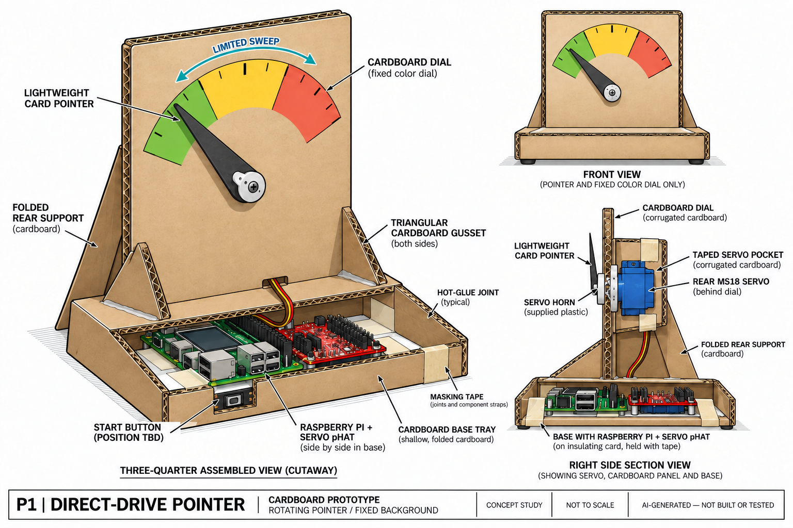

The colored dial stays fixed. A lightweight card pointer is attached to the supplied servo horn, with the MS18 mounted behind the dial in a simple taped cardboard pocket. Folded rear support and glued triangular gussets hold the upright panel. The Pi and Servo pHAT sit in a shallow base tray.

- **Input and electronics:** A start-input location is indicated near the base. The actual button and access opening remain to be determined.
- **Construction:** Cardboard dial, paper or light-card pointer, folded support, tape and glue.
- **Question to prototype:** Can the pointer move freely without rubbing, and does the structure remain stable during a button press?

##### P2: Rubber-Band-Driven Pointer

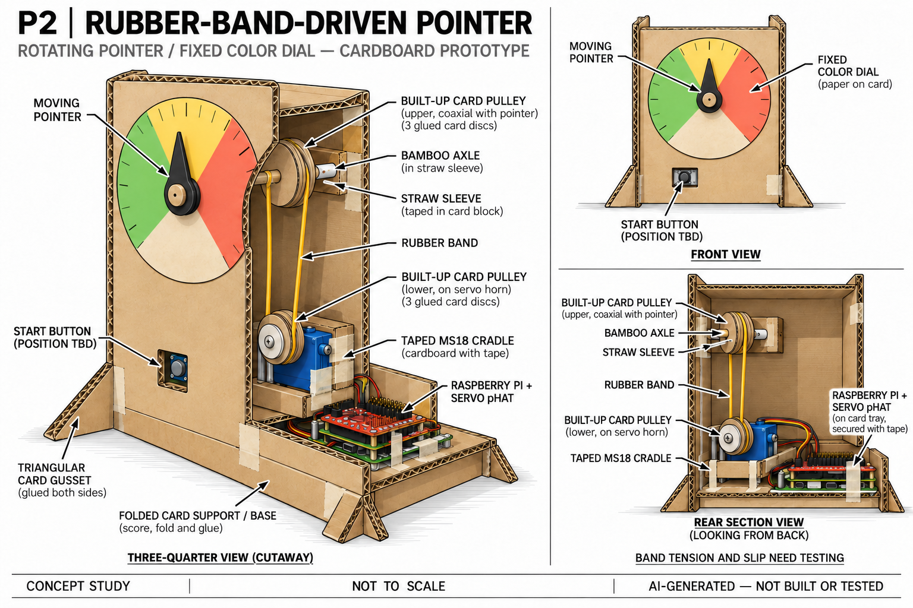

The dial remains fixed while a remotely driven pointer rotates. The MS18 sits lower behind the panel. A rubber band links two built-up card pulleys. The upper pulley turns a bamboo axle in a straw sleeve, and the pointer attaches at the front of that axle.

- **Input and electronics:** The base holds the boards clear of the band. The illustrated button position is provisional.
- **Construction:** Glued card discs for the pulleys, a rubber band, a skewer axle, a straw sleeve and folded card supports.
- **Question to prototype:** Can the band transmit the required motion without slipping or pulling the lightweight axle out of alignment?

##### B1: Rotating Cardboard Dial

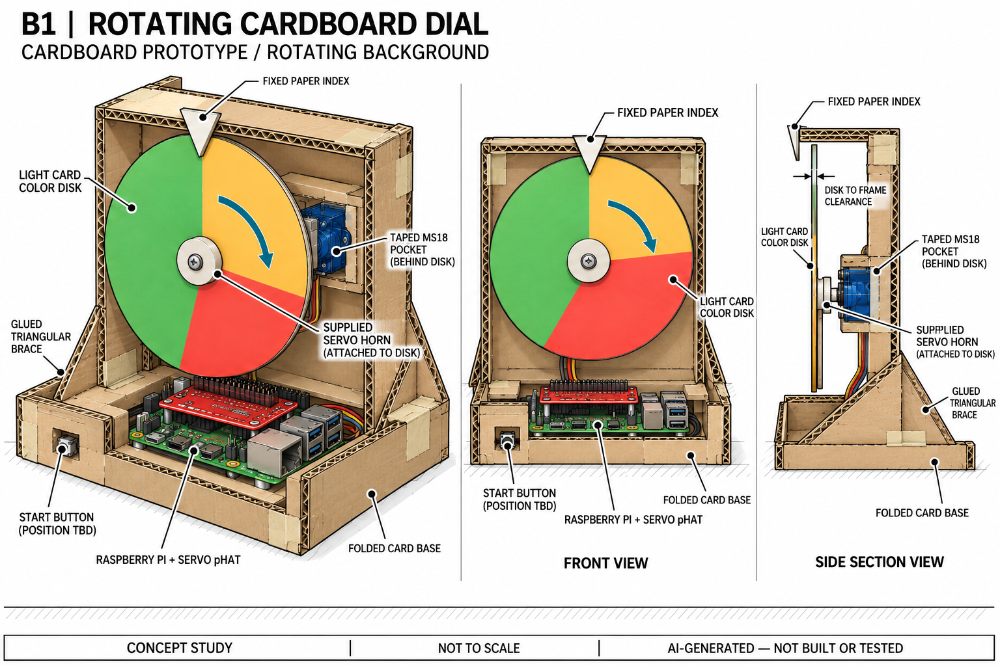

The background moves while the pointer stays fixed. A light colored disk attaches to the servo horn. The reference drawing shows an MS18 mounted on a fixed rear crosspiece. A folded-paper index is glued to the upper frame, leaving a gap above the rotating disk.

- **Input and electronics:** The boards and proposed start input are in the low folded-card base.
- **Construction:** Thin colored card for the moving disk, a stationary cardboard frame and triangular rear braces.
- **Question to prototype:** Is the disk sufficiently light and flat to turn without wobbling or touching the frame and fixed index?

##### B2: Paper Color Drum

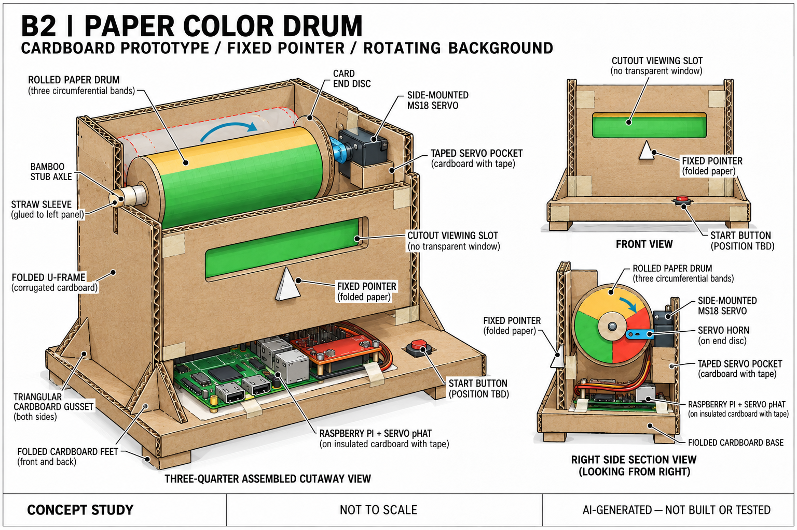

A rolled-paper drum rotates behind a slot cut into a stationary card face. Its color regions run around the drum's circumference so rotation changes the color visible through the slot. The side-mounted servo drives one end. A short skewer axle and straw sleeve support the other end. A fixed paper index marks the viewing area.

- **Input and electronics:** The controller boards sit below the drum, away from moving parts. The button position remains open.
- **Construction:** Rolled paper, card end discs, a folded U-frame, a straw sleeve and a simple front mask.
- **Question to prototype:** Can the drum rotate without binding, and does its color change communicate time progress clearly from a seated position?

##### X1: Cardboard Crank Slider

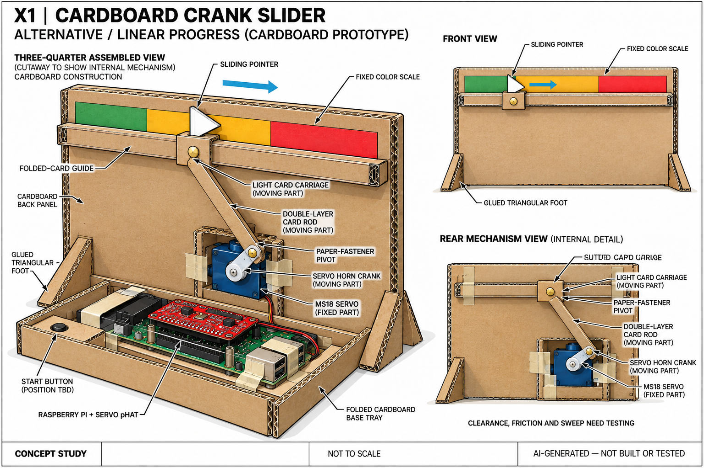

This alternative uses linear motion. The servo horn acts as a short crank. A longer card connecting rod, joined with paper fasteners, moves a light pointer carriage along a folded-card guide in front of a fixed color strip.

- **Input and electronics:** The boards and proposed start input occupy the base tray, clear of the linkage.
- **Construction:** A folded-card guide, light carriage, reinforced card rod, paper-fastener pivots and glued feet.
- **Question to prototype:** Can the carriage slide reliably without excessive friction or jamming as the crank angle changes?

#### Comparison of the layouts

| Concept | Moving element | Stationary reference | Main issue to check |
| --- | --- | --- | --- |
| P1 | Pointer | Color dial | Pointer clearance and direct mounting. |
| P2 | Pointer and transmission | Color dial | Band slip, tension and axle alignment. |
| B1 | Color disk | Paper index | Disk flatness, clearance and load. |
| B2 | Color drum | Window and paper index | Drum friction, alignment and readability. |
| X1 | Pointer carriage and linkage | Color strip | Guide friction and linkage travel. |

#### Selected design and rationale

I chose B1, the rotating cardboard dial, because I expect it to be relatively simple to build and to give the timer a more playful feel. The colored background will rotate beneath a fixed pointer.

#### Rough prototype and documentation

The Lab 4.1 rough prototype used an MS18 directly to try rotation. The [complete process and observed result](#ms18-rough-prototype) are documented in Part F.

Part D requirements and guidance

The [course Part D](https://github.com/IRL-CT/Interactive-Lab-Hub/blob/Fall2026/Lab%204/README.md#part-d) asks for five arrangement sketches, questions raised by the sketches, one selected design with a reason, and documentation of a low-fidelity physical prototype. The AI-generated reference sheets above retain their source attribution and do not establish completion of a student-authored sketch requirement.

## Part 2

### Part E
#### Build & Integrate: Sensing + Actuation

The intended interaction starts a fixed countdown with a Mini PiTFT button. The MG995 gradually turns the cardboard disk, while the TFT displays the countdown numerically. A fixed pointer is intended to make the changing disk position readable during a meal.

**Code:** [Servo experiment code](code/meal_timer_experiments/servo_lab.py).

I referred to the course's [`pi_servo_hat_test.py`](https://github.com/IRL-CT/Interactive-Lab-Hub/blob/Fall2026/Lab%204/pi_servo_hat_test.py) example and then asked Codex to write the current version for my meal timer.

**Integration status:** The complete button, display and servo interaction remains unfinished. The build process, photos and observed results are documented in [Part F](#part-f).

**Interaction diagram:** To be added for the integrated input, countdown, display and servo system.

**Personal reflection:** To be added from my own build experience.

Supplementary code files and attribution

These four files were written by Codex for this project. They are supporting project files, not four separate course submission requirements.

| File | Purpose |
| --- | --- |
| [Experiment program](code/meal_timer_experiments/servo_lab.py) | Provides midpoint, position, sweep and countdown commands, with a simulation mode. The TFT button and display are not yet integrated. |
| [Configuration](code/meal_timer_experiments/servo_config.json) | Stores the servo channel, pulse targets, movement timing and provisional countdown durations. |
| [Offline checks](code/meal_timer_experiments/test_servo_lab.py) | Checks countdown behavior, repeated starts, invalid inputs and output shutdown using simulated components, without moving a motor. |
| [Operator guide](code/meal_timer_experiments/README.md) | Explains how to use the commands, adjust parameters and distinguish software checks from physical observations. |

The [course README](https://github.com/IRL-CT/Interactive-Lab-Hub/blob/Fall2026/Lab%204/README.md#part-c) provides the basic servo example `pi_servo_hat_test.py`. The custom experiment program uses SparkFun's `pi_servo_hat` driver, which is also referenced by the course. The experiment commands and verification history are retained in the folded software record in Part F.

Planned control flow

The proposed complete interaction is:

1. Read and debounce the start input.
2. Record the start time using a monotonic clock.
3. Convert elapsed-time progress into a target within the configured pulse interval.
4. Update the servo gradually during the countdown.
5. Update the TFT time display from the same countdown state.
6. Stop at the configured endpoint when the time is over.

The intended B1 mechanism rotates the colored disk beneath a fixed pointer. The configured 1000–2000 microsecond interval needs to be matched to the chosen disk positions before an integrated run. Repeated presses during a countdown can initially be ignored. Final end and restart behavior are still open.

Part E requirements and guidance

The [course Part E](https://github.com/IRL-CT/Interactive-Lab-Hub/blob/Fall2026/Lab%204/README.md#part-e) connects at least one input to servo actuation in a dining interaction. It also calls for code, working-device media, an interaction diagram and reflection. Those physical results remain pending here.

### Part F
### Final Documentation

#### Design development

I initially wanted to combine multiple motors in the design, but I decided to start with the simplest, most direct mechanism using a single motor. I planned to build it from cardboard and basic construction materials.

The Lab 4.1 rough prototype used direct MS18 rotation. The MG995 box-and-disk construction and all six supplied photographs document the later Lab 4.2 build.

#### MS18 rough prototype

For Lab 4.1, my rough prototype used an MS18 micro servo to test the basic rotational movement for the timer. I connected the servo to channel 0 of the SparkFun Servo pHAT mounted on the Raspberry Pi. The Pi and pHAT had separate power supplies. I tested the servo on its own, without an attached cardboard dial, so I could observe its movement directly.

I ran the [MS18 Python test](code/first_servo_test.py). The script first sent a midpoint command, then moved through targets on either side, returning through the midpoint between moves. It paused briefly at each target and repeated the sequence twice. This provided a simple back-and-forth motion test before adding the rest of the mechanism.

During the observed run, the MS18 completed two back-and-forth cycles and stopped normally, without sustained buzzing. The result confirmed that the Pi and Servo pHAT could control the servo through the programmed movement sequence. This rough prototype established the basic actuation for the timer concept. The test covered unloaded servo movement, with the countdown and button input still to be integrated.

MS18 setup, test parameters and code

I connected the MS18 to channel 0 of the Servo pHAT, mounted on the Pi GPIO header. The Pi retained its own power supply, and the pHAT used a separate 5V USB-C supply.

The Pi ran a limited-range test at 50 Hz. The program first commanded the midpoint, then repeated the positions 60, 90, 120 and 90 twice, using the library's explicit 180-degree mapping. These values are command parameters, not measured shaft angles. At my request, the test was repeated so I could observe it.

The controller's timing registers matched the commands, and the channel's FULL_OFF state was confirmed at the end of the program and after it exited. The [MS18 test script](code/first_servo_test.py) is included. This check covered one unloaded MS18; the second MS18 remains untested.

#### MG995 and cardboard construction

For Lab 4.2, I chose the MG995 because I could secure it to the box more easily using its mounting ears. I adjusted the servo's travel until it covered the range I needed, secured the motor, and completed the cardboard disk. The photos below document this Lab 4.2 build. The pHAT used a separate 5V 3A supply.

**1. Marking the servo position.** I marked the mounting position on a white cardboard box and made openings for the supports. The box provides an upright body that can sit directly on a table.

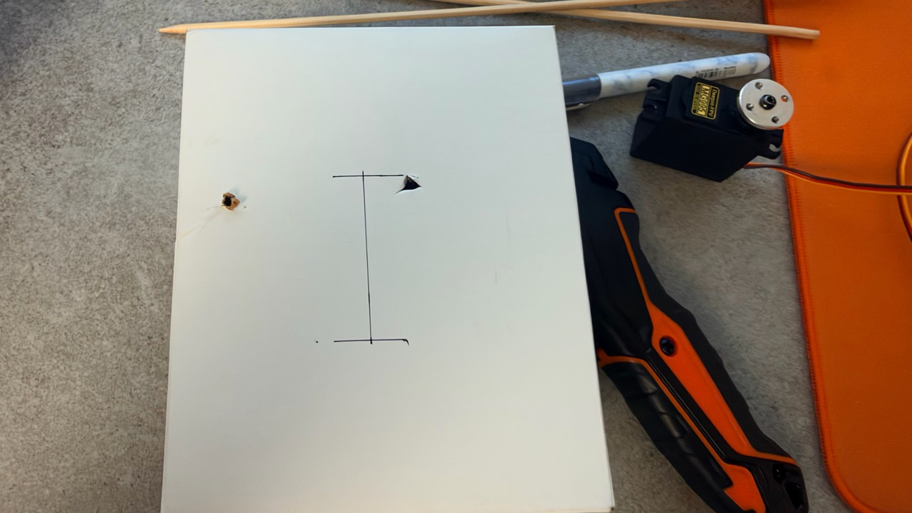

*Figure 1. Box preparation, showing the layout marks and mounting openings.*

**2. Securing the MG995.** I used short wooden pieces through the mounting ears and the box to hold the servo in place. The circular servo horn faces outward so the cardboard disk can attach to it.

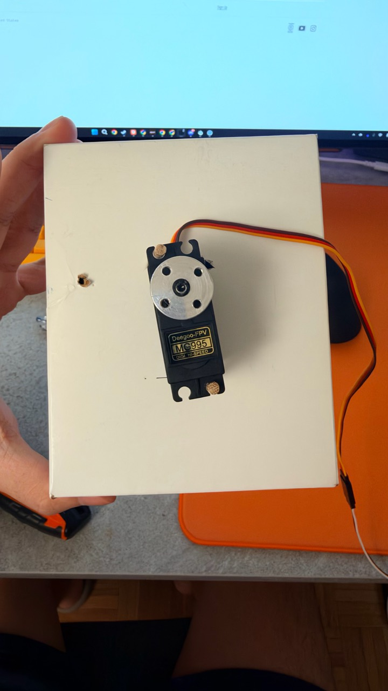

*Figure 2. The MG995 mounting arrangement and exposed circular horn.*

**3. Making the disk.** I cut a roughly circular disk from cardboard for the rotating background. This view shows the packaging side of the disk and the prepared box mounting points.

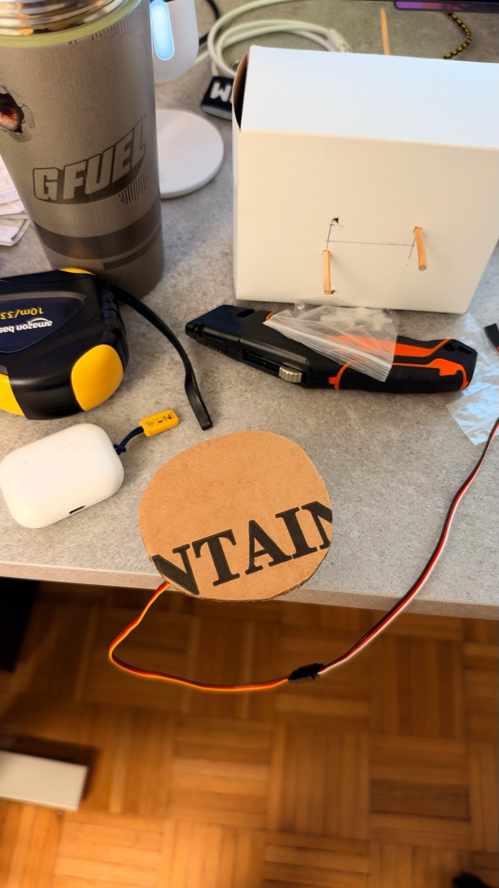

*Figure 3. The cardboard disk and prepared box supports.*

**4. Assembling the rotating face.** I attached the disk to the servo horn and marked sectors with different black patterns. These rough markings help distinguish areas while developing the mechanism. The final color scheme is still undecided.

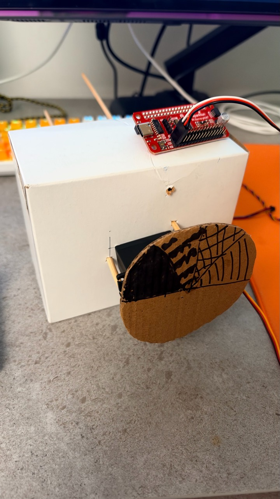

*Figure 4. The assembled cardboard prototype, with the MG995 behind the disk and the controller resting on the box.*

With the disk attached, I tested the movement and adjusted the travel to suit the prototype. The fixed pointer in the B1 concept and its final position relative to the disk still need documenting.

MG995 movement testing

**Purpose and setup.** I tested whether the MG995 could move the cardboard disk through a useful range for the timer. I first tested the servo on its own, then repeated back-and-forth movements with the disk and base attached.

**Adjustments and observations.** The initial movement was smaller than I needed, so I increased the commanded range while watching the mechanism. The servo moved to each target and stopped. Holding the same target did not make it keep rotating; changing the target made it move again. During the mounted back-and-forth tests, the disk moved smoothly and returned to the middle without rubbing or jamming.

**Result.** I found a working range that suited the prototype. The final physical angle was not measured. The mechanical movement had been tested, while the button-controlled countdown and numerical TFT display still needed integration.

Supporting code: [servo check](code/mg995_probe.py), [mounted movement check](code/mounted_turntable_check.py) and [travel adjustment](code/mg995_range_check.py).

Supplementary software preparation, commands and checks

I used the earlier servo tests to establish position-control behavior, check the mounted mechanism, and adjust its travel. The [MG995 probe](code/mg995_probe.py) checked the motor before loading it. The [mounted-turntable check](code/mounted_turntable_check.py) checked the disk and base together, and the [range-check script](code/mg995_range_check.py) supported travel adjustment. I observed smooth mounted movement without rubbing or jamming during those checks.

The prepared countdown code maps elapsed time to gradual servo position changes. Its button and display functions still need to be connected to the timer state.

| Command or feature | What it does | Boundary |
| --- | --- | --- |
| `center` | Sends the configured midpoint, holds briefly, then disables output. | This was checked on the Pi before the incident. |
| `move` | Sends an absolute target specified by pulse width or percentage of the configured interval. | A percentage is not a measured angle or an additional turn. |
| `sweep` | Moves from the midpoint to both configured endpoints and back, with optional repeated cycles. | The new package's sweep has not been run on the assembled mechanism. |
| `demo` and `timer` | Map elapsed time to gradual position changes. The demo defaults to 30 seconds; the meal timer duration is configurable. | Twenty minutes remains provisional. A complete countdown has only been simulated. |
| `--reverse` and `--wait` | Reverse countdown direction or wait for keyboard Enter after positioning. | Enter is a temporary test input. A physical button is not integrated. |
| `status`, `off` and run records | Inspect the selected PWM channel, disable an idle channel, and save command and completion records. | These do not detect physical damage, jamming, shaft angle or motor current. |

The program defaults to simulation. Adding `--hardware` enables the Pi controller, so that option must not be used with the damaged pHAT. The countdown uses a monotonic clock. At completion, it holds the endpoint briefly and disables output without recentering. The mechanism may move after holding torque is released.

A separate 15-second software pointer simulation was prepared earlier to illustrate motion. It is not a physical servo test and does not determine the normal meal duration.

The scripts were deployed before the incident to `/home/pi/Interactive-Lab-Hub/Lab 4/meal_timer_experiments`. Offline behavior checks passed locally and on the Pi at that time. A complete countdown was simulated locally. On the hardware, only the midpoint command and output status were checked during this package's preparation. The selected physical button, its wiring, debounce and long-press behavior remain to be integrated and tested.

#### Attempting the TFT display and start button

For Lab 4.2, after making the disk and mounting the servo, I tried to use one of the Mini PiTFT's built-in buttons to start the timer and add a numerical countdown display on the screen. The cardboard disk would show progress through movement and color, while the TFT would show the countdown time as numbers.

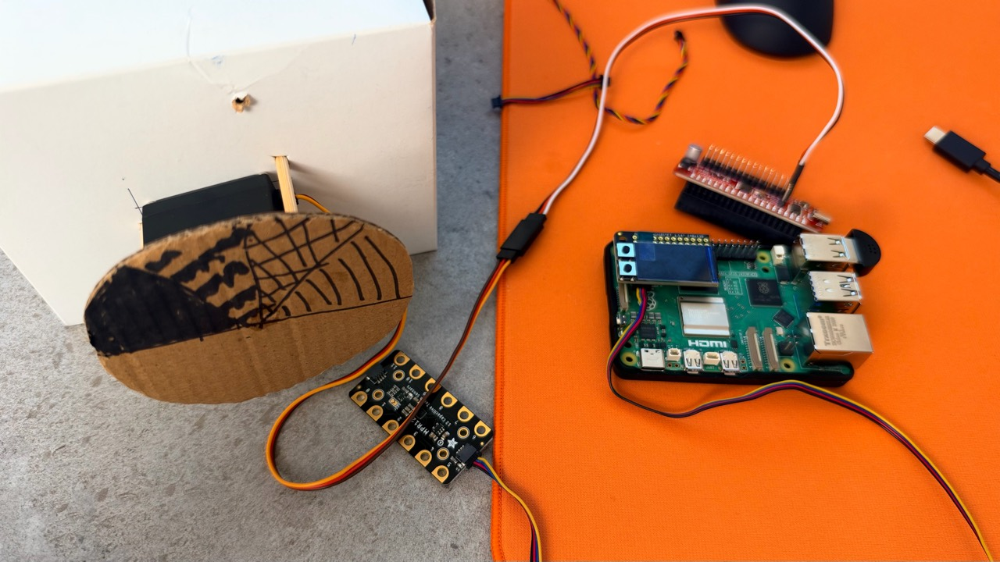

*Figure 5. The components during the display and button integration attempt. The Mini PiTFT is on the Pi, while the Servo pHAT is separate. The photo does not demonstrate a working countdown or button response.*

I could not finish this integration because the Servo pHAT emitted smoke during the connection change described below. The box, motor mounting and disk were made, but the combined input, time display and servo countdown remain unfinished.

#### Wiring incident and current hardware status

While changing the connection for the Mini PiTFT and Servo pHAT, I connected a 4-pin cable between the pHAT's Qwiic connector and the Pi connector marked `FAN`. A component on the pHAT heated up and emitted smoke, and I disconnected power. The pHAT was not plugged into the Pi GPIO header when this happened.

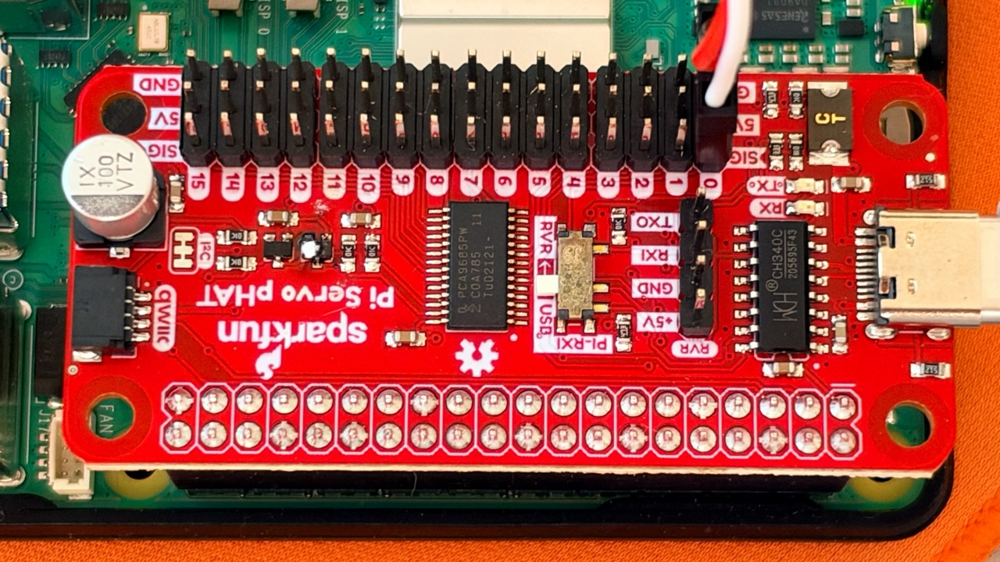

*Figure 6. The pHAT photographed after the incident. It is shown over the Pi here, but this was not the connection arrangement when the smoke occurred.*

Hardware integration is on hold. A replacement controller and the condition of the Pi have not yet been confirmed.

#### Current outcome

The box, servo mounting and cardboard disk are assembled. I found travel suitable for the mechanism, but the final color mapping, meal duration and complete button-controlled interaction remain open. Hardware recovery and the integrated countdown must be completed before recording a working use sequence.

Hardware inventory and materials across both stages

| Item | Status and intended role |
| --- | --- |
| Raspberry Pi | Intended to run the button input and countdown logic. Its condition after the wiring incident has not been verified. |
| Mini PiTFT | Mounted on the Pi during the integration attempt. Intended to display the countdown numerically and provide a start button. The combined display, button and servo interaction was not completed. |
| SparkFun Servo pHAT | Removed from service for further experiments after emitting smoke. An abnormal component is visible near the Qwiic circuitry. Replacement and electrical inspection are pending. |
| Two MS18 9g micro servos | One completed an unloaded motion test. The second remains untested. |
| One Deegoo-FPV MG995 | Chosen because its mounting ears made it easier to secure to the box. Attached to the cardboard disk, with travel adjusted to suit the prototype. Final numerical endpoints were not recorded. |
| Cardboard and paper | A white cardboard box forms the body and support. A cut cardboard disk with hand-marked sectors forms the rotating face. |
| Tape and glue | Intended for temporary mounting, joints and simple reinforcement. |
| Wooden skewers or pegs | Short pieces pass through the box and the servo mounting ears to hold the MG995 in place. |
| Rubber bands, straws and paper fasteners | Proposed materials for other layout concepts; not established as part of the selected build. |

The first build should remain simple. Extra motors are available for later exploration, but using them all is not a requirement of this prototype.

AI assistance and attribution

Codex helped me generate and debug the code and provided suggestions for implementing the design.

## Deliverables & Submission for Lab 4

Final documentation and submission guidance

The [current Part F and submission requirements](https://github.com/IRL-CT/Interactive-Lab-Hub/blob/Fall2026/Lab%204/README.md#part-f) call for writing, sketches, photos and videos covering what the prototype looks like, works like and acts like. The course does not specify a fixed number of photos or a video duration in this section.

The recommended continuation is:

1. Use the construction photos above as the record of the current form. Complete the fixed pointer and final component layout, then check whether the disk and time display are readable from a seated dining position. Document any changes to this version.
2. Keep the earlier observations, simulation results and incident record together as the iteration history. Mark concept images, hand-operated mock-ups and powered tests by their actual status.
3. After a sound controller, Pi and wiring have been checked, finish Part E by connecting the TFT start button and time display to the countdown and servo. Record what actually happens, including any remaining motion or readability problems.
4. Record a short use sequence showing a person starting the device, the color disk moving and the timer reaching its end state. A 30-second timer is a suggested filming setting, not a course requirement. One clear recording can supply evidence for both function and interaction.
5. Add a simple diagram connecting the chosen input, Pi countdown logic, servo controller, MG995 and color disk. Mark it as planned until the physical connection is tested. The written personal reflection required in Part E must come from Marius's own observations and experience.
6. Keep the Lab 4 materials linked from this README and the repository's main README. Once the record is complete, submit the Lab 4 README link to Canvas.

