# Observant Systems: Overnight Sensation

INFO5345 · Fall 2026 · Project documentation

[My Lab 5 repository](https://github.com/Mmmmmmarius/Interactive-Lab-Hub/tree/Fall2026/Lab%205) · [Course assignment](https://github.com/IRL-CT/Interactive-Lab-Hub/blob/717388f5fa74822d153aa0ceb252070cd23a5332/Lab%205/README.md) · [Remaining materials](remaining-work.md)

**Team:** Individual project

**Members:** Hanle Gu (hg542, GitHub: Mmmmmmarius)

**Project name:** Touch grass score

**Contributors and AI assistance:** I provided the Touch grass concept, capture schedule, button interaction and score direction. Codex helped with code generation, debugging, and deployment, using the course examples as references. For the later UI revision, I requested a grass pet and meme-style feedback, reviewed the proposed states, and approved the design. Codex drew the SVG character, wrote the preset captions and implemented the interface.

## Overview

**Part 1: the tools**

- [A. Environment and models](#part-a)
- [B. Person detection](#part-b)
- [C. Hand pose](#part-c)
- [D. Qwen questions and comparison](#part-d)
- [E. Detection, log and reasoning](#part-e)

**Part 2: Overnight Sensation**

- [F. Storyboard](#part-f)
- [Feedback and revised storyboard](#prep-for-part-2)
- [G. Before bed](#part-g)
- [H. During the night](#part-h)
- [I. After waking](#part-i)
- [Final documentation](#final-documentation)

## Prep for Part 1

The Lab 5 course files were added to my repository and a separate working directory on the Pi. The environment, models and USB camera were prepared, then used for live person detection, hand tracking and two short capture runs. The prototype uses the Pi, USB webcam and Mini PiTFT, with VNC for viewing the live demos.

## The Report

Touch grass score records snapshots at my computer workstation and uses local models to estimate desk time. The sections below document the tool experiments, prototype, short demonstrations and interface iterations.

# Part 1

## Part A.
### Set up your Pi for on-device AI

**Setup and models:** The course dependencies were installed in a dedicated Python virtual environment on the Pi. YOLO26n was downloaded and exported to `yolo26n_ncnn_model`. Ollama has both required models, `qwen3.5:0.8b` and `qwen3:0.6b`. Both completed local inference requests, and `qwen3.5:0.8b` identified the main vehicle in the bus image as “bus.”

**Environment:** Raspberry Pi 5 with 8 GB RAM, Debian 12, Python 3.11.2, MediaPipe 0.10.18, OpenCV 4.11.0, Ultralytics 8.4.188 and CPU-only PyTorch 2.14.1. The dependency check passed. MediaPipe initialized and processed a blank test frame during setup. Live hand tracking was subsequently tested and recorded in Part C.

**Installed-model evidence:** The screenshot below shows `ollama list` running in LXTerminal on the Pi, together with the hostname, Python version and successful dependency check.

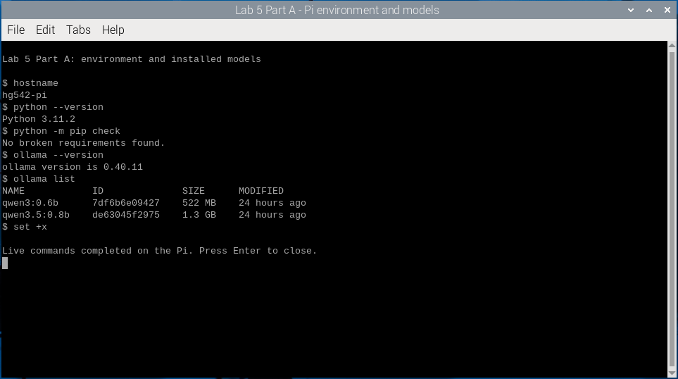

*Both required Qwen models are installed locally. This is a capture of the Pi desktop terminal.*

**Image detection:** After checking the course's [bus sample](https://ultralytics.com/images/bus.jpg), I selected my own street-scene image for the image-input option in Part A. The original image is saved as `user-street-input.png` on the Pi and is available for later image-input experiments. The existing YOLO26n NCNN model processed it locally with `imgsz=640` and `conf=0.25`.

| Input image | Detected objects | Recorded inference time |
| --- | --- | --- |
| Bus street scene | Four people and one bus | 66.2 ms |
| My selected street photo | Six person boxes, one bus and one traffic light | 125.8 ms |

These timings are from individual still-image runs, not a live-camera frame-rate measurement.

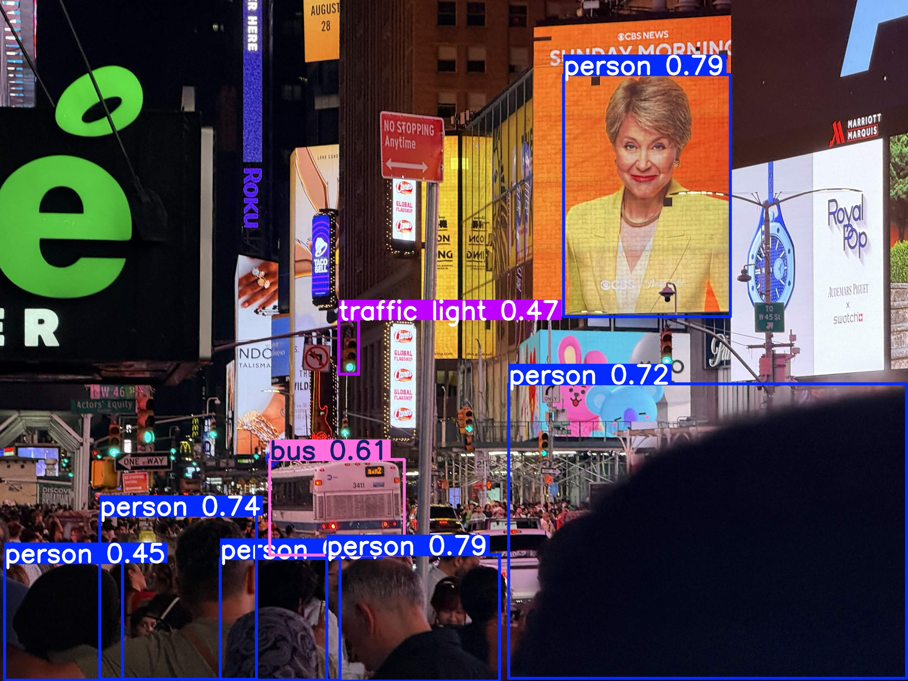

*Output produced on the Pi from my selected image. The six person detections include the portrait on the large billboard.*

**Observed limitations:** The model labeled the billboard portrait as a person and left many smaller or partly hidden pedestrians unmarked. The bus and one traffic light were also detected. The distant crowd remained largely undetected, showing how performance changes when people occupy only a small part of the image.

<details>
<summary>Original image, parameters and recorded output</summary>

[Original image](assets/part-a/user-street-input.png) · [Run record](evidence/part-a-user-image/README.md) · [Detection data](evidence/part-a-user-image/detection.json) · [Actual terminal output](evidence/part-a-user-image/inference-log-verified.txt)

The original image is 2880 × 2160 pixels. The recorded model input was 640 × 640, with a confidence threshold of 0.25. This test used a saved image, with no webcam capture.

</details>

<details>
<summary>Earlier sample-image results</summary>


NCNN output from the Ultralytics bus sample, with four person detections and one bus.

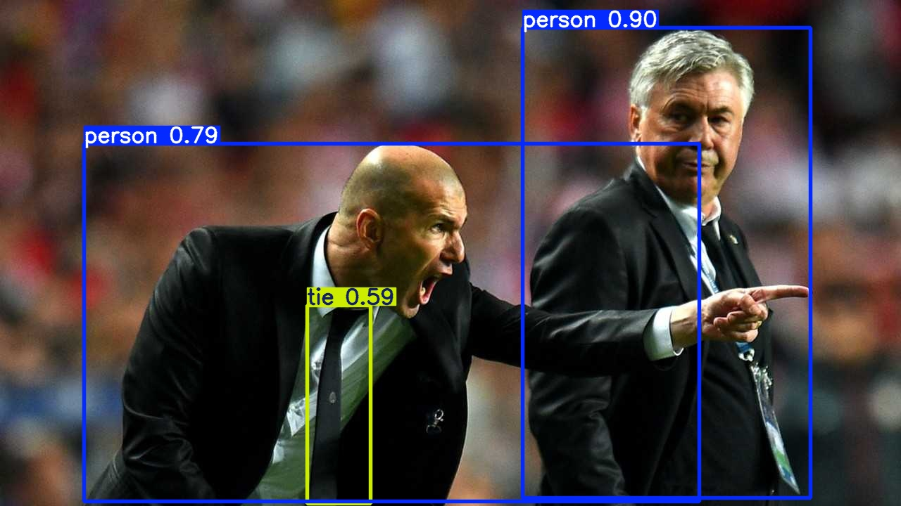

The earlier second test used the public [zidane.jpg sample](https://ultralytics.com/images/zidane.jpg), saved as `snap.jpg` on the Pi. It detected two people and one tie, with 112.1 ms inference time. My selected street photo now serves as the main second-image example; the earlier result is retained here.

</details>

<details>
<summary>Recorded terminal output for the earlier image tests</summary>

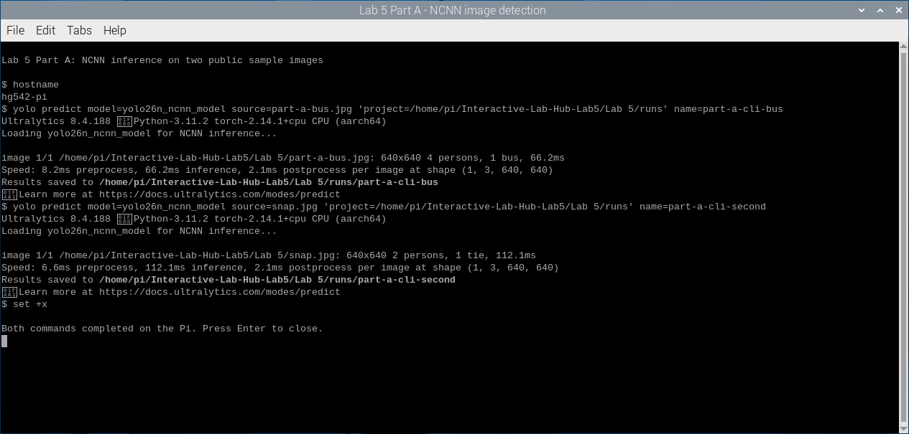

Both commands completed successfully. The output directories are inside the Lab 5 folder. [Raw command output](evidence/part-a/part-a-cli-yolo-local.txt) and [installation and verification records](evidence/part-a/README.md) are retained locally.

</details>

**Part A status:** The environment setup, NCNN export, image tests, both Qwen downloads and required model-list screenshot are complete. The current image-input example uses my selected street photo, with the annotated output and actual results recorded above. Live person and hand-tracking experiments are documented in Parts B and C.

<details>
<summary>Setup adjustments and verification scope</summary>

CPU-only PyTorch was installed from its official source. OpenCV and OpenCV-contrib were aligned at 4.11.0.86, with NumPy 1.26.4. UTF-8 settings resolved the terminal encoding error, and the course requirements file was kept unchanged.

An absolute output path kept the image results inside the Lab 5 directory. Both Qwen models loaded and answered requests, but their answer accuracy was assessed separately in Part D.

</details>

## Part B.
### See: recognize people in real time with YOLO

**Evidence:** The screenshot below shows the phone-photo test.

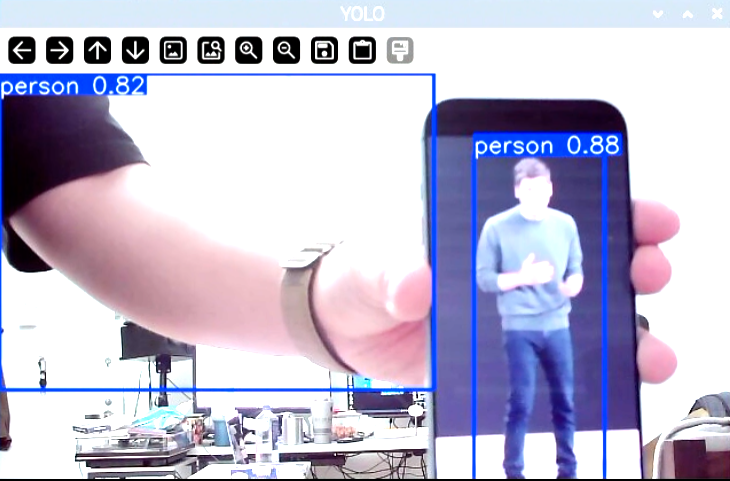

*The person pictured on the phone screen received a confidence of 0.88. A separate box over my partly visible body received 0.82.*

**Baseline check:** When I entered the camera frame, a person box appeared. It disappeared after I left the frame. This basic test worked at the default confidence threshold of 0.4.

**Turning away:** The person box remained visible when I turned my back to the camera.

**Phone-photo test:** I had to hold the phone very close to the camera before the person in the photo was detected. The screenshot shows that a displayed photograph can receive a person label, even though that person is not physically present in the room.

| Situation | What actually happened | Possible cause |
| --- | --- | --- |
| 1. A person displayed on a phone screen | The photo was detected as a person with confidence 0.88 when I held the phone close to the camera. It was not detected when the phone was farther away. | The displayed image contains human visual features that can trigger the person class. Moving the phone closer makes the pictured person larger in the camera image, which may explain the distance dependence. |
| 2. Partial occlusion | During the occlusion test, the person box repeatedly appeared and disappeared instead of remaining stable. | Fewer visible body features may make detection less reliable. The original script evaluates each frame independently, so a missed detection or a confidence drop below 0.4 immediately removes the box. |
| 3. A portrait on a large outdoor billboard, in the saved-image experiment from Part A | The model drew a person box around the billboard portrait in my street photo. The person was represented in an image rather than physically standing in the street. | A two-dimensional picture can contain the visual features used by the person class. A person label alone does not distinguish a displayed portrait from someone physically present. This was a still-image result, not another live-camera trial. |

**Confidence comparison:** Using the unmodified course script, I lowered the confidence threshold from 0.4 to 0.2 and repeated the same occlusion test. The person box became more stable. A 0.7 trial was started, but I moved on before recording a full observation.

## Part C.
### See more: hands and pose with MediaPipe

**Setup:** I started with the course's `hand_pose.py` on the Pi, then used a separate copy with a calibrated volume range. The original course file is preserved. The video below records the calibrated version in use. The [calibration patch and notes](assets/code/hand-pose-calibration.md) document the exact change.

**Evidence:** [Watch my hand-volume demonstration](assets/part-c/hand-volume-demo.mp4). The recording is about 28 seconds long. These frames were extracted from my recording and cropped to the demo window for readability.

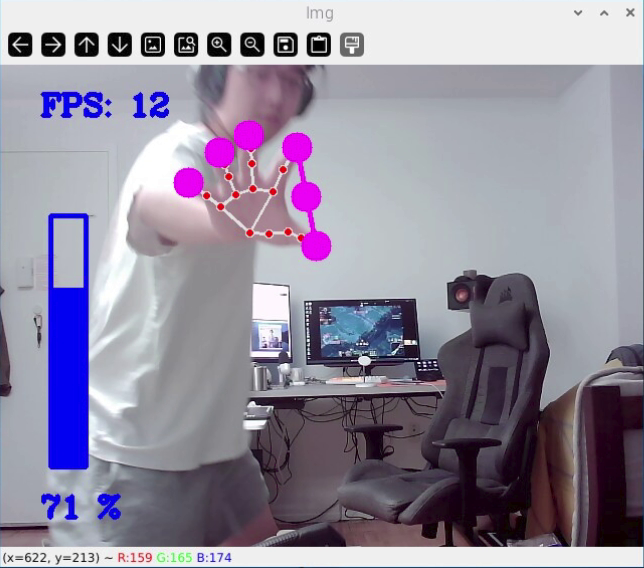

*00:09.500: Intermediate control. The hand landmarks and thumb-to-index line are visible, and the volume indicator reads 71%.*

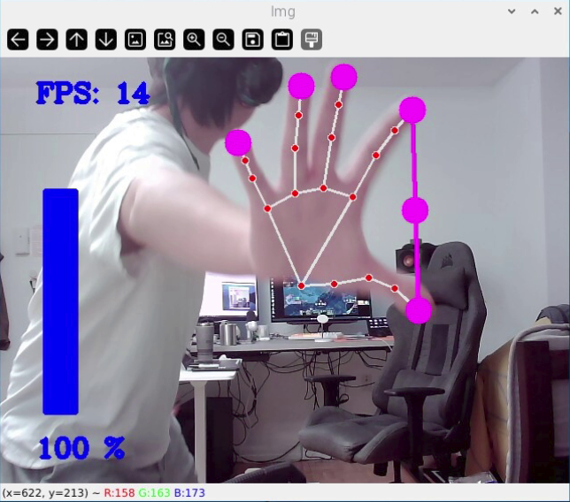

*00:10.500: Full range. Spreading my thumb and index finger fills the bar and reaches 100%.*

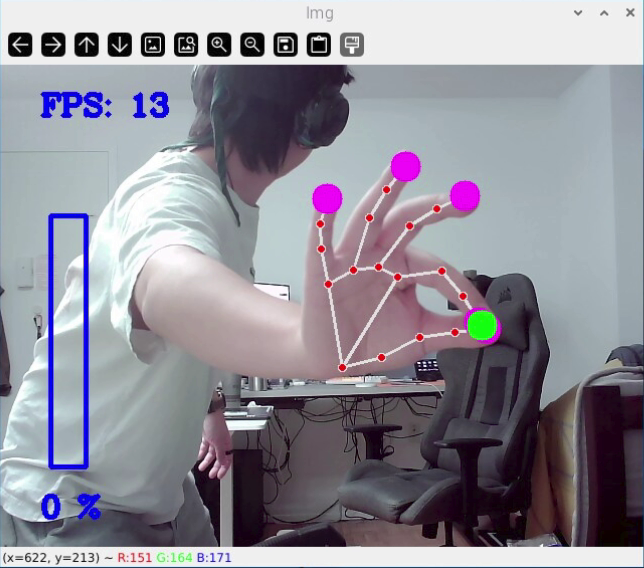

*00:13.500: Minimum setting. Bringing the fingertips together empties the bar and sets the indicator to 0%. The green marker shows that the fingertips are close together.*

**What I observed:** At first, fully spreading my thumb and index finger did not bring the displayed volume to 100%. The original script mapped 50 to 300 pixels to the full volume range. Codex reduced the upper endpoint to 120 pixels in a separate copy, keeping the lower endpoint at 50. In this recording, with my hand clearly visible in front of the camera, I could reach both 100% and 0% and repeat the open-and-pinch movement several times.

The script uses the tracked thumb and index fingertips to measure their distance in the image. It maps that distance to a volume percentage and updates the blue bar, so the hand movement produces a continuous control value. Because the measurement is in pixels, the camera distance and hand angle can affect the reading.

This clip demonstrates pinch control and the displayed volume range. The 0% pinch frames are separate from the Quiet Coyote gesture, whose on-screen message is not shown here. The recording contains no captured sound, so the screenshots document the visual response rather than an audible volume comparison.

**How I would use pose tracking:** [Add my own application idea: which hand, face or body movement the system would detect, and what response that movement would trigger.]

## Part D.
### Reason: run Qwen on the Pi with Ollama

**Run:** The four trials used the unchanged course `ask_qwen.py` on the Pi, with thinking disabled, temperature 0.3 and a 120-token output limit. Codex selected the two additional test questions, ran the commands and organized the results. The answers below are copied verbatim, including their errors. Trial 3 uses a synthetic example log supplied in the question, not recorded camera data.

| Trial | Model | Question | Actual answer | Time in seconds |
| --- | --- | --- | --- | --- |
| 1 | qwen3.5:0.8b | Tell me a bit about the history of Roosevelt Island. | Roosevelt Island is the largest island in Manhattan, originally built as a military reserve during World War II to house troops stationed on Staten Island. The name was chosen by President Franklin D. Roosevelt after his wife Eleanor Roosevelt, who had been born there. Today, it serves as a major tourist destination and home to the famous Roosevelt Island Zoo. | 35.9 |
| 2 | qwen3.5:0.8b | A timer starts at 20 minutes. After 7 minutes and 30 seconds, how much time remains? Answer in minutes and seconds. | The timer has started for 20 minutes and the elapsed time is 7 minutes and 30 seconds, so the remaining time is 12 minutes and 30 seconds. | 6.9 |
| 3 | qwen3.5:0.8b | Use only this example log: 22:00 no person detected; 22:05 one person detected; 22:06 no person detected. When was a person detected, and can this log tell us why they were there? | The log indicates that a person was detected at 22:05 but not again between 22:00 and 22:06. This suggests the individual may have been present for a short period before leaving, as no further activity is recorded in the provided data. | 13.0 |
| Comparison | qwen3:0.6b | Tell me a bit about the history of Roosevelt Island. | Roosevelt Island is a small island located off the coast of California, known for its unique geological features and historical significance. It was formed by the collapse of the island of the Pacific, which was once a massive landmass. The island has been a vital part of the region's history, with early settlers and explorers arriving there in the 19th century. It played a key role in the development of the area, serving as a base for various industries and a hub for trade and transportation. Today, Roosevelt Island remains an important part of the region's cultural and ecological identity. | 15.7 |

**Comparison:** On the same history question, `qwen3:0.6b` returned in 15.7 seconds and `qwen3.5:0.8b` in 35.9 seconds. Neither answer was reliable. The 0.8B model supplied an incorrect World War II origin and naming story, while the 0.6B model placed the island off California and invented its formation. The 0.6B answer also used five sentences despite the three-sentence instruction. These are single request times, including any model loading, rather than a controlled speed benchmark. The 0.8B model was already loaded for trials 2 and 3.

**Answer checks:**

- **History:** Neither response included any of the four reference facts listed in the lab. Roosevelt Island was previously Blackwell's Island, then Welfare Island, and received its current name in 1973. Cornell Tech opened its campus there in 2017. These facts were checked against the [National Park Service history](https://home.nps.gov/places/blackwell-s-island-new-york-city.htm) and [Cornell Tech's campus-opening announcement](https://tech.cornell.edu/news/cornell-tech-campus-opens-on-roosevelt-island-marking-transformational-mile/).
- **Timer:** The answer was correct: 20:00 minus 7:30 leaves 12:30.
- **Example log:** The model correctly identified 22:05, but then suggested that the person left. A missing detection at 22:06 does not establish that they left, and these three readings cannot explain why they were there. The answer did not clearly state that limitation.

**Records:** [Commands, settings and original output](evidence/part-d-qwen/README.md).

## Part E.
### Connect: from YOLO readings to Qwen reasoning

**Log:** Codex ran the unchanged course `yolo_to_qwen.py --seconds 60` on the Pi and prompted me to enter and leave the camera view. I confirmed that I left and returned during the test. The script saved 15 readings, writing a line only when the detection result changed. The [original log](evidence/part-e-pipeline/watch_log.txt) is reproduced below.

```text
19:39:04 1 person(s) at center/far
19:39:05 nobody
19:39:06 1 person(s) at center/far
19:39:06 nobody
19:39:18 1 person(s) at center/far
19:39:18 nobody
19:39:21 1 person(s) at center/far
19:39:21 nobody
19:39:22 1 person(s) at center/far
19:39:23 nobody
19:39:23 1 person(s) at center/far
19:39:25 nobody
19:39:38 1 person(s) at center/far
19:39:43 nobody
19:39:56 1 person(s) at center/far
```

**Qwen response:** `qwen3.5:0.8b` took 18.5 seconds to answer the default question, “How many people were there, what were they doing, and did anything change?” Its unedited response was:

> There are 5 people total, with all of them located at the center or far away throughout the entire 61-second observation. No one was ever seen moving; every single reading indicates a static state where everyone is either "at center/far" or "nobody." Therefore, no activity occurred during this period.

**Observation:** The camera, interpreter, log and Qwen request all ran successfully, but the summary was unreliable. Each reading contained either one detected person at `center/far` or `nobody`. Nothing in the log supports the model's claim of five people, and these readings cannot establish the number of distinct visitors. Its conclusion that no activity occurred also disagreed with my actual entry and exit during the test.

YOLO produced the boxes, and `interpret()` converted them into coarse count, position and distance labels. Qwen received these words rather than camera images. The frequent switches between a person and `nobody` show why a missing detection should not automatically be treated as someone leaving. The requested left/close movement was not represented in the log, so this run did not demonstrate reliable position changes.

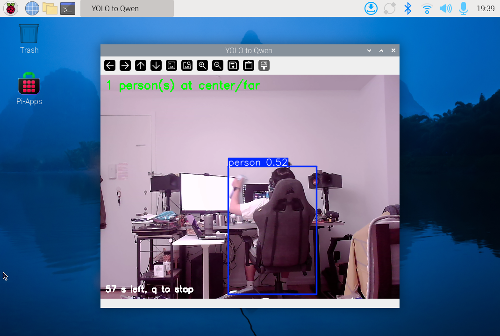

*The course window during the run. The screenshot shows a detected person partly hidden by the chair and the interpreter's `center/far` label.*

[Full output, settings and verification](evidence/part-e-pipeline/README.md).

# Lab 5 Part 2: Overnight Sensation

I chose to collect photos during the day and process them after a bedtime button press. The morning interaction is a report on the local web interface. The two completed short demonstrations use an explicitly labeled simulated day.

## Part F.
### Read Part 2 and storyboard your night-time interaction

**Initial idea:** I want the camera to take one photo every five minutes, beginning at 8:00 AM each day in New York. Before bed, I will press a button on the Mini PiTFT to stop that day's collection and start processing the saved photos. Qwen will estimate my time in front of the computer and give me a "Touch grass score" from 0 to 100. The longer I spend there, the higher the score should be. When I wake up, I will view the estimate, score and explanation through a web interface on my local network. Collection begins again at 8:00 AM the next day.

**Storyboard:** [Insert my own three-panel storyboard showing the bedtime hand-off, processing while asleep, and the report after waking. The written sequence below records the selected concept.]

1. **Before bed:** I press a button on the Mini PiTFT to stop collection and start processing the day's photos. The screen acknowledges the hand-off with a Processing message.
2. **While asleep:** The Pi processes the saved photos with YOLO and gives the timestamped detection records to Qwen. Qwen estimates my time in front of the computer and assigns a Touch grass score, with more time leading to a higher score.
3. **When awake:** I open the local web interface from a device on the same network to view Qwen's estimated time, Touch grass score and explanation.

## Prep for Part 2

**Feedback received:** [Record the actual feedback on your initial storyboard.]

**Changes made:** The implementation now passes timestamped person-detection labels and their counts to Qwen instead of asking for an open-ended description of the room. This follows the recorded Part E failure, where Qwen invented a larger group and an unsupported account of activity. The custom version preserves missing samples as unknown, saves the original model answer, and checks counts, arithmetic and simulation labels before displaying a report. After the short demos, the input was simplified into structured counts, the camera position was adjusted, and the approved Grass bro interface replaced the plain report. These are documented technical iterations; changes based on actual peer feedback remain to be added after that feedback is supplied.

**Revised storyboard:** [Insert the revised version.]

**Location and consent:** The demo camera faced my computer workstation and chair. After the first run missed most of my presence, I adjusted the camera so more of my upper body was visible, then checked live detection before the second run. The [placement-check photo](evidence/express-demo/placement-check-2/frame.jpg) records the revised view. The camera also captures part of the surrounding room. [Confirm who else could appear in this space and record their consent, or confirm that no other person is affected.]

## Part G.
### Design the interaction before

**Interaction before bed:** The implementation uses either Mini PiTFT button to close the current batch and start one analysis job. A press after midnight but before 8:00 AM still belongs to the previous day's batch. Holding a button produces one event, and another press during processing does not create a second job. The next day begins collecting at 8:00 AM.

**Input and acknowledgement:** I pressed a Mini PiTFT button to begin the express demo and pressed it again after capture ended to start analysis. The saved event log identifies both inputs as physical-button events. The first press started capture at 22:10:10, and the second started analysis at 22:26:40, New York time. The web page reached **Your simulated report is ready** after processing. The display service remained active, although I did not record a close-up of the TFT screen for this run.

**Express demo:** I used 15 minutes of real capture to demonstrate a clearly labeled simulated day. The camera took one photo every 30 seconds and stopped automatically after 15 minutes. Each sampling slot represents 24 simulated minutes, covering a fictional 08:00–20:00 day. The photos and raw log retain their actual timestamps. The second button press simulates handing the data over for night-time processing. The regular daily schedule remains unchanged.

The run is documented in Parts H and I. The [first button-event log](evidence/express-demo/run-222640-878587/button-events.jsonl) and [second button-event log](evidence/express-demo/run-231511-490646/button-events.jsonl) preserve the physical inputs. Instructions for repeating it are in [Express demo guide](express-demo.md). This is a completed short demonstration, not a full-day or overnight measurement.

## Part H.
### Incorporate the observant system

**First 15-minute express run:** I collected real photos for 15 minutes, then pressed the Mini PiTFT button again to process them. The following results describe a **simulated 08:00–20:00 day**, not 12 hours of actual observation.

| Item | Recorded result |
| --- | --- |
| Actual capture window | November 1, 22:10:10–22:25:10, New York time. |
| Sampling | Every 30 seconds, 30 saved photos, no failed captures. |
| Simulation | 30 slots of 24 simulated minutes each, covering 08:00–20:00. |
| Analysis trigger | Second physical button press at 22:26:40. |
| Completion | Report saved at 22:27:17, about 36 seconds after the press. The Qwen request took about 31 seconds. |
| Detector result | Person detected in 1 photo, not detected in 29, no unknown slots. |
| My observation | I estimate that I was at the desk for about 70% of the test. Exact leave and return times were not recorded. |

**Detection problem:** The camera was behind the chair. In the saved photos, the chair back hides most of my torso when I face the monitors. YOLO detected me when I leaned sideways and exposed more of my upper body, but missed visible head and shoulder regions in other frames. Therefore, a successful capture did not mean a successful presence detection, and “no person detected” did not establish that I had left.

| Sideways posture, detected | Facing the desk, missed |
| --- | --- |
| 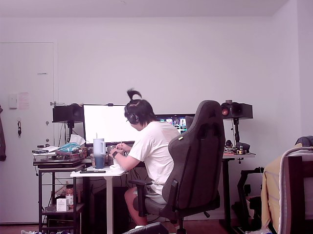 | 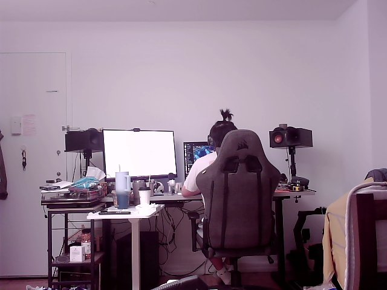 |

I replayed the same 30 saved photos without changing the original run. Increasing the requested input size from 320 to 640 at confidence 0.4 still detected a person in only one photo. Using size 640 and confidence 0.2 detected a person in four photos. This did not resolve the mismatch with my observation. I then repositioned the camera to expose more of my upper body and confirmed that live detection worked. I closed the live preview to release the camera and prepared a separate second 15-minute run.

**Evidence:** The [run record](evidence/express-demo/run-222640-878587/README.md) links the original photos, button events, detector replay and Qwen output. The [night_log.jsonl](evidence/express-demo/run-222640-878587/express-20261101-215722-412583/jobs/222640-878587/night_log.jsonl) records analysis of these short-demo photos and retains their real capture timestamps. It is not an overnight capture log. The actual web screenshot is in Part I.

**Second run after repositioning:** I used the physical button to start another 15-minute capture and pressed it again to begin analysis. The sampling and simulated-day mapping stayed the same.

| Item | Second-run result |
| --- | --- |
| Actual capture window | November 1, 22:54:58–23:09:58, New York time. |
| Sampling | 30 saved photos, no failed captures. |
| Analysis | Physical button at 23:15:11; report saved at 23:16:41, about 90 seconds later. |
| Detection | Person detected in 23 photos, not detected in 7, no unknown slots. |
| Image review | Of the 7 negative photos, 2 show an empty seat and 5 still show a person. |
| Initial report | Needs review because Qwen returned a score outside the allowed range. A later replay of these same photos passed, as documented in Part I. |

The new position improved the observed detection count, but the saved images still reveal missed detections in seated poses. The two runs contain different activities, so their counts are not a controlled accuracy comparison. Reviewing individual snapshots also does not establish exact continuous desk time.

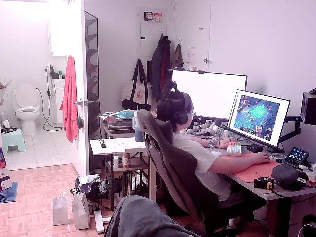

*Second run, 22:58:30: my upper body is visible, but this saved frame was classified as no person detected. The [second-run record](evidence/express-demo/run-231511-490646/README.md) preserves all photos, detections, button events and the rejected model output.*

**Earlier setup check:** Before this run, a separate three-photo check returned 0.1 minutes and 0 points. Its [screenshots and model comparisons](evidence/touch-grass-build/README.md) are retained separately.

**Overnight run:** A full-day collection followed by night-time processing is still pending. The normal schedule starts collection at 8:00 AM in New York and ends when I press a Mini PiTFT button before bed. The available evidence here covers the two 15-minute demonstrations and their reanalysis, not a completed normal day or night.

## Part I.
### Design the interaction after

**Current demo result:** I reused the second run's 30 saved photos instead of collecting a new batch. After improved the Qwen input and validation, the deployed program completed the replay and displayed **552 simulated minutes, or 9 hours 12 minutes, and 100/100**. The result describes the fictional 08:00–20:00 day mapped from 15 real minutes. It is not a measured full day.

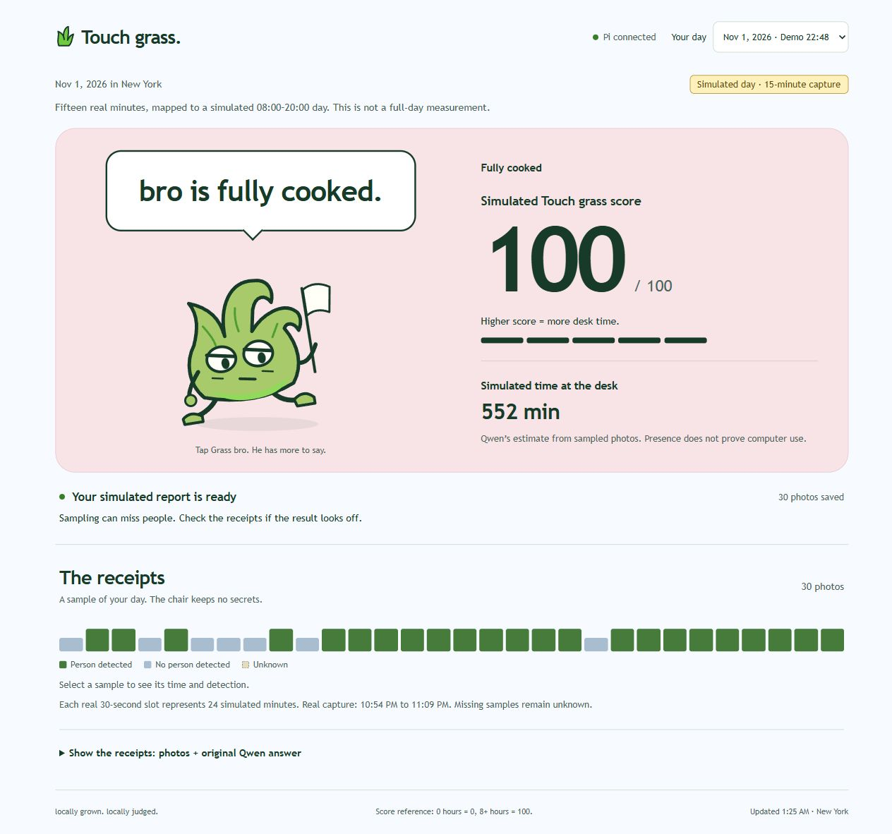

*The new interface running on the Pi. The report still uses the same 15-minute capture mapped to a simulated day. The earlier interface screenshot remains in the [replay record](evidence/express-demo/qwen-replay-v3/README.md).*

**What changed:** Python now supplies a structured summary of the detector labels: 23 present samples, 7 absent samples, zero unknown samples and 1,440 simulated seconds per sample. Qwen still calculates the desk minutes and score. The program checks the returned counts, arithmetic relationships, score range and simulation labels. It rejects an incorrect answer and can request up to three attempts, preserving every original reply. It never replaces Qwen's numbers with calculated fallback values.

The final `qwen3:0.6b` request kept reasoning enabled. Qwen returned this answer in about 29 seconds on its first attempt; the entire deployed replay took about 34 seconds:

```json
{
  "present_samples": 23,
  "absent_samples": 7,
  "unknown_samples": 0,
  "is_simulation": true,
  "estimated_desk_minutes": 552,
  "score": 100,
  "summary": "Simulated day: 552 minutes, score 100.",
  "uncertainty": "Simulation: unknown slots: 0, possible missed detections and that presence does not prove computer use."
}
```

**Verification:** The same 30 photo files, detector labels and sampling slots were preserved. The accepted values match Qwen's raw response and the live LAN page. The earlier rejected report remains in its original job directory. Separate diagnostic cases for one positive sample and zero positives with unknown samples also passed. Those diagnostic inputs are checks, not additional observations. Source files, prompts, attempts and the screenshot are linked in the [replay record](evidence/express-demo/qwen-replay-v3/README.md).

**Interaction after waking:** I open the Pi's web page from a computer or phone on the same network. Grass bro, a small grass character, reacts to the selected report. The page shows Qwen's estimated desk time and Touch grass score beside the character. I can click or tap the pet to cycle through short preset reactions, or select a timeline sample to see its actual and simulated time. Captured photos and the unchanged Qwen answer remain available under "Show the receipts." Until a valid report is available, the page shows no score.

**Interface iteration:** I wanted the feedback to feel more playful, so the plain report became a grass pet with five expressions and short English captions. Codex implemented the approved character, captions and responsive layout. The visual bands below do not change the scoring rule or Qwen's returned numbers.

| Score | Grass bro's reaction | Default caption |
| --- | --- | --- |
| 0–24 | Relaxed leaves and a smile. | "we're chillin." |
| 25–49 | A raised eyebrow and a sideways look. | "locked in, huh?" |
| 50–74 | Hands on hips. | "touch some grass, brother." |
| 75–99 | Wide eyes and raised hands. | "are we deadass rn?" |
| 100 | Drooping leaves and a small white flag. | "bro is fully cooked." |

Waiting, collecting, ready to analyze, processing, validation failure and disconnection also have their own expressions. The processing caption is "let me cook," while the text underneath explains what the device is doing. These captions are preset interface text, separate from Qwen's original response. The simulation label stays above the result. A low score does not establish that I went outside.

**Interface check:** The deployed page correctly displayed this report's 552 simulated minutes and 100 points. Clicking the pet changed its caption without changing the result, and the caption persisted through automatic updates. The earlier setup report still displayed 0.1 minutes and 0 points with its setup-test label. Desktop, tablet and narrow phone layouts were checked in the browser. The current browser requested reduced motion, so captions changed while animation stayed off. All original photos, detection records and reports were preserved. This was a UI update using existing data, not a new capture or model run.

<details>
<summary>Phone layout and character states</summary>

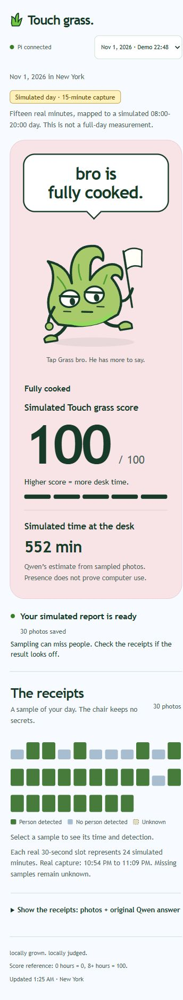

*Browser check at a phone-sized viewport. This is not a photograph of a physical phone.*

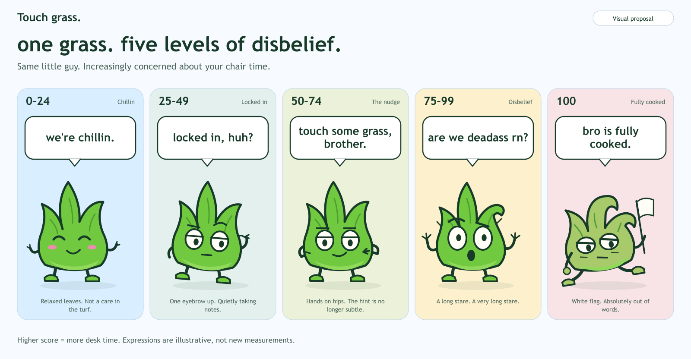

*Character design sheet showing the five visual bands, not five separate experimental results.*

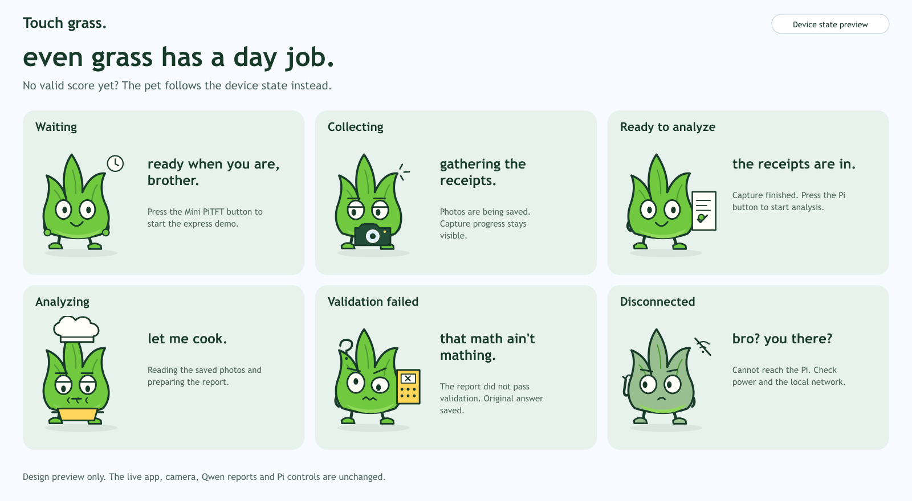

*Runtime character design sheet. State selection was checked in software; this UI update did not start another capture or deliberately disconnect the Pi.*

The [UI verification record](evidence/grass-ui/README.md) preserves the deployment checks and screenshots.

</details>

<details>
<summary>Earlier model outputs and iteration record</summary>

**First express demo output:** The LAN page displayed **24 simulated minutes** at the desk and a **Touch grass score of 50/100**. These are Qwen's actual returned values. The page explicitly labels the result as a simulated day based on 15 minutes of real capture. The screenshot preserves the original output, including the incorrect score.

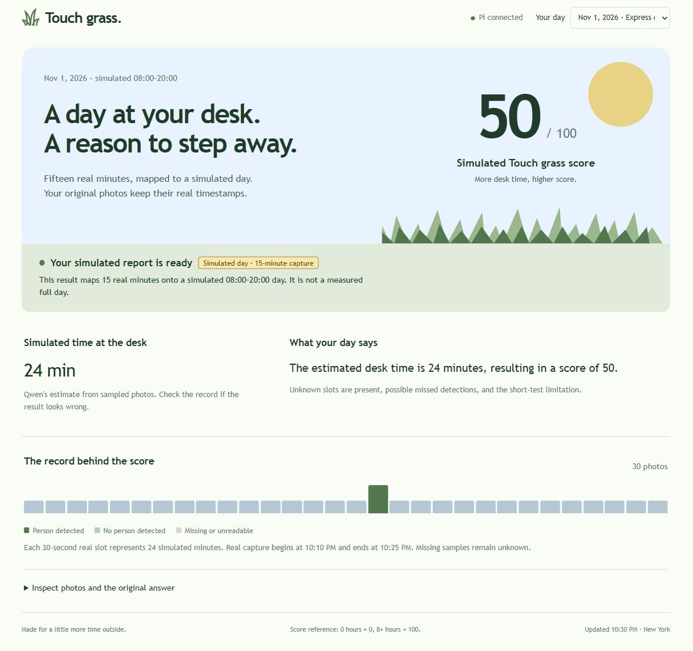

The original model answer was:

```json
{
  "estimated_desk_minutes": 24,
  "score": 50,
  "summary": "The estimated desk time is 24 minutes, resulting in a score of 50.",
  "uncertainty": "Unknown slots are present, possible missed detections, and the short-test limitation."
}
```

**Comparison with the log:** One positive slot corresponds to 24 simulated minutes, so the model's duration follows the detector log. However, that log missed much of my presence and disagrees with my approximate 70% observation. The score is also incorrect: under the configured rule, `round(24 / 4.8)` is **5**, not 50. This is a review calculation, not a replacement score or a corrected estimate of my actual desk time. Qwen also claimed there were unknown slots, although the input contained none. The software's format and range checks accepted the response, but those checks did not establish factual or arithmetic accuracy.

**Second express demo output:** After the camera was repositioned, `qwen3:0.6b` took about 85 seconds to return the following original answer:

```json
{
  "estimated_desk_minutes": 672,
  "score": 140,
  "summary": "The estimated desk time is 672 minutes, resulting in a score of 140, with some uncertainty due to the sampling.",
  "uncertainty": "Unknown slots (28 P's) may indicate missed detections, and the short-test limitation limits the accuracy of the estimate."
}
```

The actual input contains **23 positive slots and zero unknown slots**. A diagnostic calculation gives `23 × 24 = 552` simulated minutes. Applying the configured eight-hour scale gives a capped score of **100**. These are checks against the detector log, not replacement app results or verified actual desk time. Qwen miscounted the positive slots, exceeded the score limit, claimed unknown slots and omitted the requested simulation label from its own prose.

The application rejected the answer with `The model score must be an integer from 0 to 100.` Its saved state and live status API both showed **needs_review**. The original answer remains saved, and no corrected score was substituted. The [second-run evidence](evidence/express-demo/run-231511-490646/README.md) includes the report and checks. A new browser screenshot was unavailable for this run.

</details>

**Outcome:** The replay now produces a valid simulated report from the existing detector log. The five visible-person frames missed by YOLO remain a detection limitation; better arithmetic does not recover those observations. The current score scale saturates at eight estimated hours, so this simulation reaches 100. A full-day capture and real night-time run are still pending.

## Final documentation

**Looks like:** The prototype uses the existing Raspberry Pi 5, USB webcam and Mini PiTFT. The camera faces the workstation, and a physical button on the small display provides the hand-off input. The browser presents Grass bro beside the score and estimated time, with the sample timeline and original evidence below. The [camera-view record](evidence/express-demo/placement-check-2/frame.jpg) and the deployed interface screenshot in Part I show these views. [Add a photograph of the physical Pi, display and camera in their actual placement; a camera-view screenshot does not show the device itself.]

**Works like:** A background service saves timestamped photos every five minutes from 8:00 AM. A Mini PiTFT button ends collection and queues processing. YOLO converts each saved image into person detected, no person detected or unknown. Qwen receives structured detection counts and the sampling interval, calculates desk time and produces the score and explanation. Rejection-only checks verify its counts, arithmetic and simulation labels before the report is displayed. The web page reads the saved report. Missing samples remain unknown. The current build uses the full camera view and cannot identify me or prove that I was using the computer. Full-day data is still pending; the [operating notes](implementation-and-operation.md) describe the deployed version.

**Acts like:** In both express demos, I pressed the Mini PiTFT button to start capture and pressed it again after capture ended to hand the photos to analysis. The first run displayed the returned values in the LAN page. The second run initially produced a report that needed review.

**Prototype changes:** A separate express mode compresses the observation period while keeping real timestamps and marking simulated results. Replaying the first run at a larger requested input size and a lower confidence threshold did not resolve chair occlusion. I changed the camera position and checked live detection before the second run. More photos were detected, but five visible-person frames were still missed. Both original reports are preserved, including the second run's rejected score. The later update supplied structured detection counts, kept Qwen reasoning enabled and added arithmetic checks with bounded retries. Replaying the same photos then produced the accepted simulated result shown above. The later Grass bro interface adds score-based expressions and clickable preset captions while keeping those same observations and model results.

**Whole-system video:** [Add a short recording showing the physical button press, device acknowledgement, processing and the resulting web report. If it uses express mode, keep the simulated-day label visible.] The existing [Part C recording](assets/part-c/hand-volume-demo.mp4) demonstrates hand control only and does not replace this whole-system video.

## Deliverables & Submission for Lab 5

**README:** [Lab 5 documentation](README.md) in [my repository](https://github.com/Mmmmmmarius/Interactive-Lab-Hub/tree/Fall2026/Lab%205). Canvas submission is still pending.

**Code:** [Download the current custom source](assets/code/touch-grass-source.zip), including the Grass bro UI, tests, service examples, a configuration template and English usage instructions. The archive excludes model weights, captured photos and live credentials. [Source snapshot notes](assets/code/touch-grass-source.md) and [implementation and operating notes](implementation-and-operation.md) explain the files and the deployed version. The [Part C calibration patch](assets/code/hand-pose-calibration.patch) records the separate change to the course hand demo. The current custom source is included in this repository snapshot.

**Night log:** The current report uses the [second capture's replay log](evidence/express-demo/qwen-replay-v3/233249-174790/night_log.jsonl), [sampling slots](evidence/express-demo/qwen-replay-v3/233249-174790/sampling-slots.json), [structured model input](evidence/express-demo/qwen-replay-v3/233249-174790/evidence.json) and [accepted Qwen report](evidence/express-demo/qwen-replay-v3/233249-174790/report.json). These contain the real 15-minute capture and its simulated-day mapping. A normal full-day capture and night-time processing log still need to be added.

**Supporting material:**

- [Part A environment and image tests](evidence/part-a/README.md) and [my selected-image result](evidence/part-a-user-image/README.md).
- [Part B phone-photo screenshot](assets/part-b/phone-photo-person.png) and [Part C demonstration video](assets/part-c/hand-volume-demo.mp4).
- [Part D questions and model outputs](evidence/part-d-qwen/README.md) and [Part E pipeline log](evidence/part-e-pipeline/README.md).
- [First express demo](evidence/express-demo/run-222640-878587/README.md), [second express demo](evidence/express-demo/run-231511-490646/README.md), and [successful reanalysis](evidence/express-demo/qwen-replay-v3/README.md).
- [Grass bro interface screenshots and checks](evidence/grass-ui/README.md), [score-expression design sheet](ui-preview/score-states.png), and [runtime-expression design sheet](ui-preview/device-states.png).

The original and revised storyboards, actual peer feedback, physical placement photograph, and whole-system video are still pending at their marked sections above.
