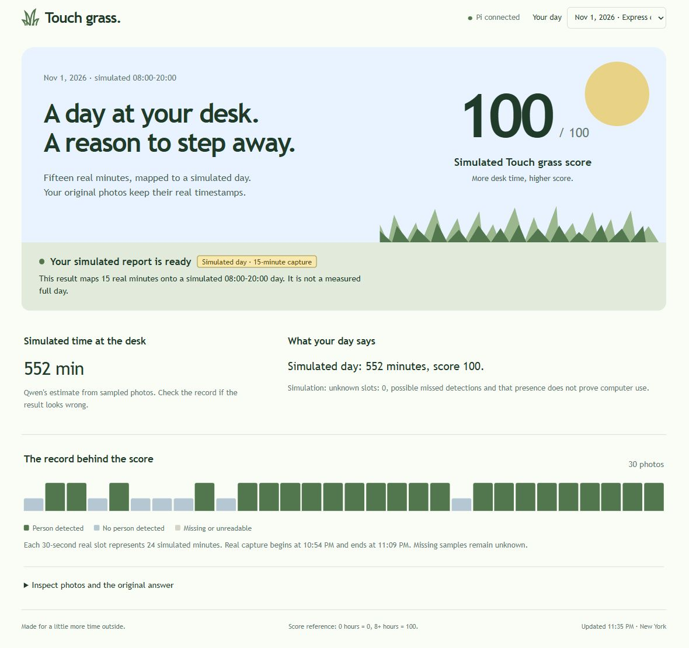

# Qwen input revision and replay

The deployed replay of the second capture succeeded. **Qwen generated 552 simulated minutes and 100 points.** This remains a real 15-minute capture mapped to a fictional 08:00–20:00 day.



## Input and validation

The photos and YOLO output are unchanged: 23 samples are labeled present, 7 absent and none unknown. The revised input supplies these counts and the configured interval instead of asking the small model to count a long sequence of letters. Python aggregates observation counts. Qwen computes desk minutes and the score. Validation checks arithmetic relationships, but only accepts or rejects the model reply; it does not publish a substitute value or repair a number. Every retry is saved separately, with a maximum of three attempts.

The JSON schema specifies score bounds. Runtime checks also verify the echoed counts, finite duration, duration relationship, rounded and capped score, recording type, and explicit simulation and unknown-slot labels. These checks do not prove that every sentence in a model response is true or that a missed person was absent.

## Iterations and measured results

| Trial | Actual outcome |
| --- | --- |
| Structured counts, reasoning disabled | Three rejected attempts. Qwen copied 23 into desk minutes rather than converting the sampling interval. All attempts are preserved under `qwen-counted-evidence-v2/`. |
| Structured counts, reasoning enabled | The saved second-run input returned 552 minutes and 100 points, passing validation on its first attempt in 26.61 seconds. |
| One-positive diagnostic fixture | Qwen returned 24 minutes and 5 points in 26.98 seconds. This is a synthetic check, not a new capture. |
| Zero-positive, two-unknown fixture | Qwen returned 0 minutes and 0 points in 25.67 seconds, preserving the two unknown slots. This is a synthetic check. |
| Deployed replay of all 30 photos | Software-triggered at November 1, 23:32:49 New York time. Report saved at 23:33:23. Total 34.04 seconds; model request 28.58 seconds; first attempt passed. |

The accepted raw answer is:

```json
{
  "present_samples": 23,
  "absent_samples": 7,
  "unknown_samples": 0,
  "is_simulation": true,
  "estimated_desk_minutes": 552,
  "score": 100,
  "summary": "Simulated day: 552 minutes, score 100.",
  "uncertainty": "Simulation: unknown slots: 0, possible missed detections and that presence does not prove computer use."
}
```

## Evidence and limits

- [Actual replay report](233249-174790/report.json), [prompt](233249-174790/prompt.txt), [raw answer](233249-174790/raw-response.txt) and [validation](233249-174790/attempt-1/validation.json).
- [Structured evidence](233249-174790/evidence.json) and [detector log](233249-174790/night_log.jsonl).
- [Previous failed run and unchanged source photos](../run-231511-490646/README.md).
- [Verification](verification.json), [final manifest](day-after.json) and [live status snapshot](result-state.json).

The original 30 photos, detector output, sampling slots and previous failed job were checked against the Pi and preserved. Windows and Pi each passed 19 unit tests, including both previously observed numerical failures, finite bounds, fractional intervals, unknown counts, simulation labels, preservation of raw answers and exhausted retries with no fallback report. The browser displayed the same numbers as the accepted raw model answer and reported no console warnings or errors.

The five missed visible-person frames remain unchanged. Therefore, this result is arithmetically consistent with the detector log, not a corrected measurement of actual desk occupancy. A score of 100 follows the existing eight-hour cap. No full-day or overnight validation is claimed.

Application changes are in `worker.py`, the new `reasoning.py` and `test_reasoning.py`. The Pi backup is `/home/pi/touch-grass/backups/counted-evidence-v3-20261101-233248`. The teacher's scripts and detector settings were not changed. No additional package was installed.

After updating and checking the documentation, Codex reopened the unchanged teacher `yolo_person.py` preview at Marius's request and verified the live camera window in TigerVNC. The [reopened-window screenshot](yolo-reopened.jpg) records that final step. Press **q** in the YOLO window before the next capture so the camera is available to the sampler.
