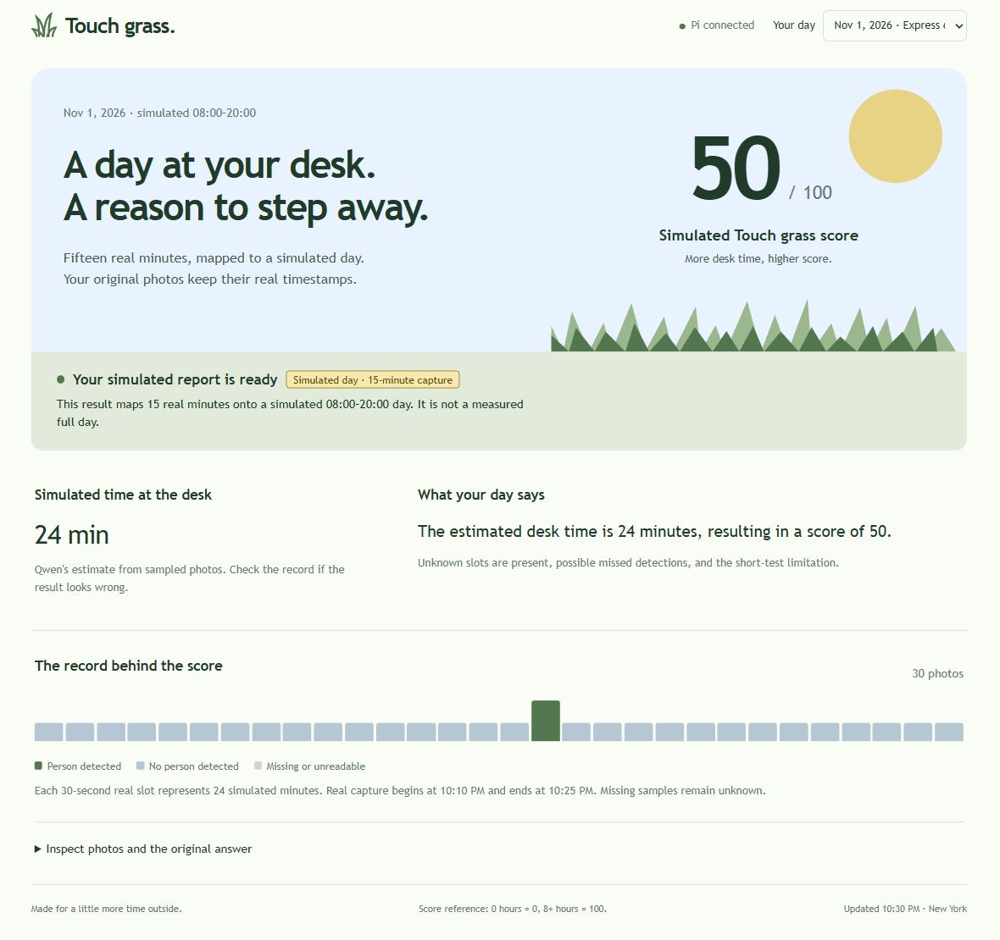

# Express demo: actual capture, simulated day

This run used 15 minutes of real camera capture and mapped the samples to a fictional 08:00–20:00 day. The simulated hours and score are not measurements of an actual full day.

## Recorded sequence

All actual times below are on November 1 in New York.

| Event | Evidence |
| --- | --- |
| First physical Mini PiTFT press | 22:10:10, capture started. |
| Capture window | 22:10:10–22:25:10, exactly 900 seconds. |
| Saved photos | 30 images, every 30 seconds, no failed captures. First photo at 22:10:12, last at 22:24:42. |
| Second physical press | 22:26:40, analysis started. |
| Report saved | 22:27:17, about 36 seconds after the second press. |
| Qwen request | `qwen3:0.6b`, reasoning enabled, 31.08 seconds. |
| Original detection | 1 present, 29 absent, 0 unknown. |
| User observation | Marius reported being present for approximately 70% of the test. Exact transitions were not recorded. |

Both inputs are identified as `physical-button` in [button-events.jsonl](button-events.jsonl). The web page was observed with the completed report. The hardware service remained active, but this does not establish visual confirmation of each TFT screen state.

## Returned result and review

Qwen returned **24 simulated desk minutes and a score of 50**. The single positive slot represents 24 simulated minutes, but the configured scoring rule gives `round(24 / 4.8) = 5`. The returned score of 50 is wrong. Qwen also said unknown slots were present, although the input contains none.

The response passed the application's format and numeric-range checks. That flag does not establish arithmetic correctness or agreement with actual presence. The original report and screenshot retain the model's values. The review calculation was not substituted into the report.

The [full viewport capture](ui-report.jpg) is also retained. Both are real browser screenshots. The detail image uses the browser's rectangular screenshot option to remove outer whitespace, not to change page content. The page was refreshed before capture so that the current simulation labels were loaded. Browser error and warning logs were empty at the final check.

## Why presence was underestimated

The saved pictures show a rear camera view of a tall chair. The chair hides much of the person's torso during normal seated use. At 22:18:12, leaning sideways exposed more upper body and produced the sole positive detection. At 22:21:12 and 22:24:42, visible head and shoulder regions were missed. This directly demonstrates false negatives; absence labels cannot establish that the person was away.

- [Detected sideways posture at 22:18:12](express-20261101-215722-412583/photos/221811-660185.jpg).
- [Missed seated posture at 22:21:12](express-20261101-215722-412583/photos/222110-757931.jpg).
- [Another missed seated posture at 22:24:42](express-20261101-215722-412583/photos/222441-347990.jpg).

Codex replayed the unchanged 30 photos through the installed YOLO NCNN model. These are detector diagnostics, not a new observation session or a replacement Qwen report.

| Requested input size | Confidence threshold | Photos with a person detected |
| --- | --- | --- |
| 320, original run | 0.4 | 1 of 30 |
| 640, replay | 0.4 | 1 of 30 |
| 640, replay | 0.2 | 4 of 30 |

The replay did not resolve the discrepancy with the user's observation. The next recommended experiment is to place the camera at the front side of the desk, keeping head, shoulders and upper body visible while seated. Neither that placement change nor a new capture was performed in this review. The production detector configuration remains unchanged.

## Source files and verification

- [Original batch manifest](express-20261101-215722-412583/day.json) and the adjacent `photos/` directory contain the actual capture record.
- [Original detector log](express-20261101-215722-412583/jobs/222640-878587/night_log.jsonl) preserves actual capture timestamps.
- [Sampling slots](express-20261101-215722-412583/jobs/222640-878587/sampling-slots.json) preserve separate actual and simulated time fields.
- [Prompt](express-20261101-215722-412583/jobs/222640-878587/prompt.txt), [raw answer](express-20261101-215722-412583/jobs/222640-878587/raw-response.txt), and [saved report](express-20261101-215722-412583/jobs/222640-878587/report.json) retain the model interaction.
- [Web API state](result-state.json) records the completed run and device status.
- [Detector replay](detector-replay.json) contains settings, per-image boxes, confidence values and counts.
- [Verification](verification.json) contains source hashes, file checks, timing and the review findings. All 30 photos decoded successfully, and every archived original batch file matched its counterpart on the Pi.

This evidence establishes that the physical inputs, capture, analysis and web output completed. It also records substantial detection and reasoning errors. It does not establish reliable desk-time measurement, full-day observation, a real overnight run or exact user presence times.
