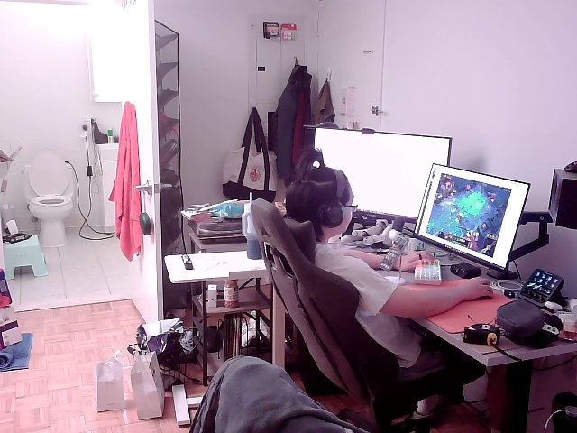
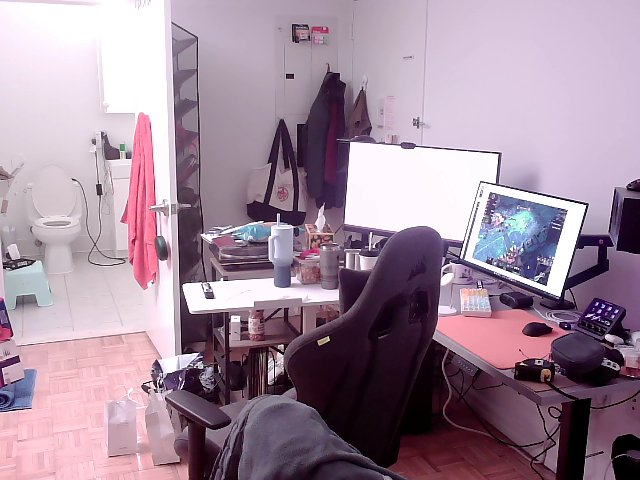

# Second express demo: capture completed, report rejected

This records a real 15-minute capture mapped to a **simulated 08:00–20:00 day**. It is not a full-day measurement. The model output and detector labels below are preserved without correction.

| Check | Result |
| --- | --- |
| Physical start | November 1, 22:54:58, New York time. |
| Capture end | 23:09:58, exactly 900 seconds after start. |
| Photos | 30 readable 640 × 480 JPEGs; no failed captures. |
| Physical analysis trigger | 23:15:11. |
| Report saved | 23:16:41; 90.01 seconds after the button event. |
| Qwen request | 84.72 seconds, qwen3:0.6b. |
| Detector labels | 23 present, 7 absent, 0 unknown. |
| Qwen output | 672 simulated minutes, 140 points. |
| Application result | needs_review; score rejected as outside 0–100. |

## Checks and remaining problems

The recorded input contains 23 positive slots. Each represents 24 simulated minutes, so a diagnostic calculation gives 552 minutes and a capped score of 100 under the configured rule. These checks are separate from the application output. Qwen's original values were not replaced. Its prose also invents unknown slots and omits the requested simulation label.

Codex visually reviewed all seven photos labeled absent. The first photo and the photo at 23:04:59 show an empty seat. The other five show a seated person and are false negatives. This review does not establish continuous presence between snapshots or a controlled accuracy comparison with the first run.

Archived files match their Pi originals by SHA-256. The first run's manifest is unchanged. Both application services were active when checked. The browser connection was unavailable, so this run's final status was verified through the live HTTP API and saved files; no new browser screenshot is presented.

## Source evidence

- [Capture manifest](express-20261101-224820-867740/day.json).
- [Physical-button events](button-events.jsonl).
- [Detector log](express-20261101-224820-867740/jobs/231511-490646/night_log.jsonl).
- [Model prompt](express-20261101-224820-867740/jobs/231511-490646/prompt.txt).
- [Original model answer](express-20261101-224820-867740/jobs/231511-490646/raw-response.txt).
- [Rejected report](express-20261101-224820-867740/jobs/231511-490646/report.json).
- [Live status snapshot](result-state.json).
- [Verification and hashes](verification.json).

No application code, model settings or scores were changed during this inspection. The next proposed change is to improve Qwen's input structure and response validation, then replay this saved batch without another capture.
