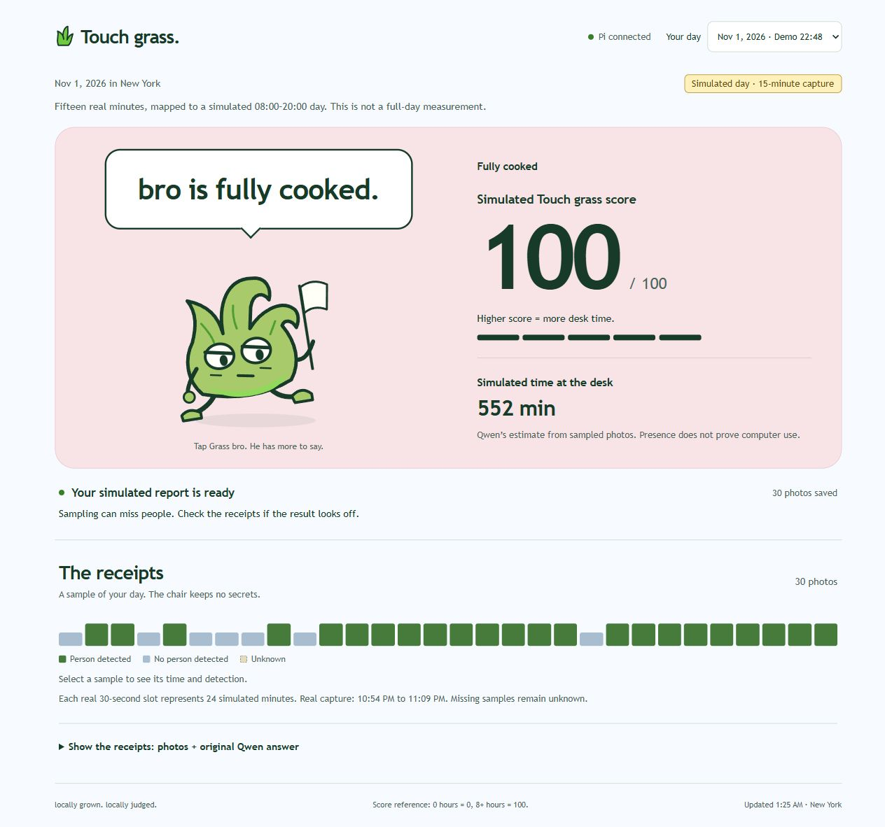

# Grass bro UI：部署与检查

11 月 2 日，Marius 批准此前展示的草宠物方案，要求部署到 Pi 并更新 README。本轮已完成，访问 [Pi 页面](http://192.168.1.39:8080/)。

## 这次改了什么

网页采用同一只草角色，按五档分数选择表情。点击角色可切换同档台词，键盘 Enter 也可操作。等待、采集、采集结束、分析、校验失败和离线使用对应姿态与说明。切换日期会先清空旧结果，避免把上一份报告显示成新日期的结果。自动轮询不重置台词，也不重播点击反馈。

源码在工作区 `Study HQ/Projects/INFO5345/Lab5/touch_grass/ui/`。`build-ui.cjs` 生成 Pi 服务已有路由所需的三个静态文件。Pi 只替换了 `/home/pi/touch-grass/web/index.html`、`style.css` 和 `app.js`，没有改后端、模型、采样或 GPIO。

旧界面备份位于 Pi 的 `/home/pi/touch-grass/backups/grass-ui-20261102-012015/web/`。两个服务及实时 YOLO 均保持原进程，部署未重新启动采集或分析。

## 实际截图

当前报告仍来自第二轮真实采集的 30 张照片，映射成模拟的 08:00–20:00。网页显示 Qwen 原有结果：552 模拟分钟、100 分。首屏继续标记 15 分钟采集和模拟一天。

- [手机宽度截图](mobile.jpg)：浏览器宽度 360px，不是实体手机拍照。
- [平板宽度截图](tablet.jpg)：浏览器宽度 768px，角色被点击后显示同档另一句台词。
- [短时设置测试截图](setup-low-score.jpg)：旧设置批次显示 0.1 分钟与 0 分，不代表一整天。
- [展开后的照片记录](receipts.jpg)：原始采样及实际拍摄时间仍能查看。

## 验证结果

| 检查 | 结果 |
| --- | --- |
| 模型数值 | 当前网页与保存的 Qwen 原答一致，时长与分数没有重新计算。 |
| 数据保留 | 对比部署前后哈希，第二轮的照片、任务和报告文件全部一致。后端 Python 文件也一致。 |
| 文件部署 | 三个 HTTP 返回文件与本地构建字节一致。备份已保存。 |
| 服务与实时预览 | `touch-grass.service` 和 `touch-grass-screen.service` 保持运行及原进程。原实时 YOLO 进程仍在。 |
| 分数与运行状态 | Node 检查覆盖五档边界、无效值、处理中不显示旧报告、六种运行姿态及轮询状态标识。通过。 |
| 点击与键盘 | 鼠标点击、Enter 均切换台词。经过自动更新，选择的台词保留。分数不变。 |
| 历史报告 | 页面在模拟报告和旧设置测试间正常切换，模拟标签与设置测试标签各自正确。 |
| 记录入口 | 时间线能显示真实及模拟时间，原始模型回答一致，照片正常加载。 |
| 响应布局 | 360px、375px、768px 和 1280px 检查均无横向溢出。已查看手机、平板和桌面截图。 |
| 减少动态效果 | 浏览器报告启用了减少动态效果。点击时反应样式正常添加，但最终动画为关闭，台词仍改变。没有修改系统设置。 |
| 浏览器错误 | 检查期间没有捕获到网页脚本警告或错误。 |

除两个已有报告外，其余分档和运行状态通过本地软件输入检查，没有为验证 UI 新建采集、故意断开 Pi 或伪造实验数据。未检查关闭减少动态效果后的实际运动。窄屏检查不是实体手机验收。

本轮 UI 不改善人物检测。第二轮已有的五张可见人物漏检仍保留，完整一天与夜间处理仍待实际运行。

## 检查文件

- [部署记录](deployment.json)：备份位置和最终部署文件哈希。
- [部署前状态](before.json) 与 [部署后状态](after.json)：后端、演示数据、服务及 YOLO 对照。
- [当前报告状态](state.json)：本轮使用的现有模拟结果。
- [浏览器检查](browser-checks.json)：可见结果、布局、交互和减少动态效果记录。
- [文档检查](document-checks.json)：原有作业结构、历史错误和本地链接检查。

构建、测试和恢复方式见 [实现与运行](../../%E5%AE%9E%E7%8E%B0%E4%B8%8E%E8%BF%90%E8%A1%8C.md)。角色设计来源及表达参考保留在 [UI 改版提案](../../UI%E6%94%B9%E7%89%88%E6%8F%90%E6%A1%88.md)。
