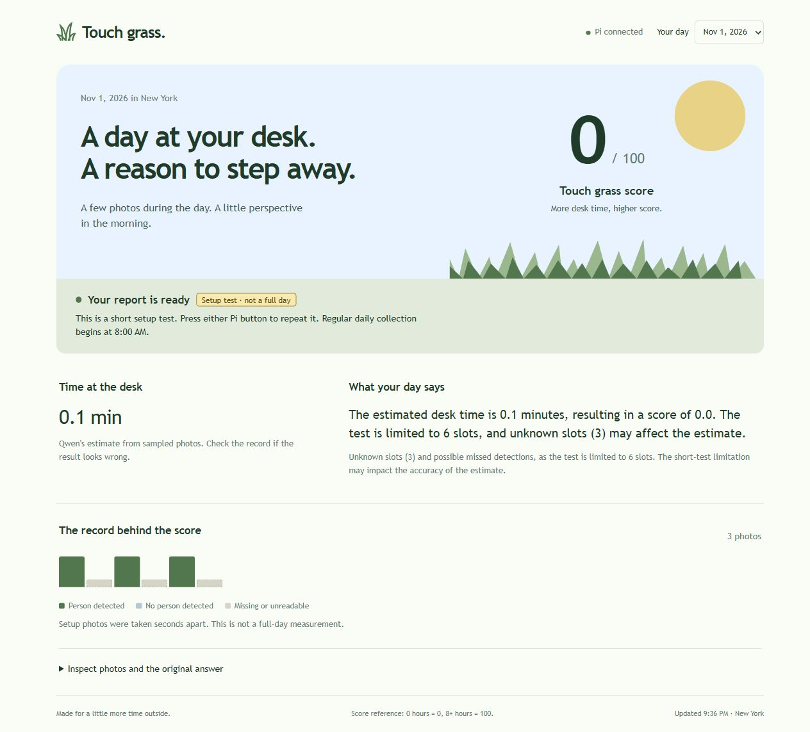

# Touch grass 部署与短时检查

这份记录对应真实 Pi 服务、真实摄像头照片和模型返回。短时数据仅用于检查流程，不代表一天的桌前时间。

## 部署结果

Windows 源码与 Pi 上十个对应文件的哈希一致。主服务和 Mini PiTFT 服务均在运行，并已启用开机启动。旧 `piscreen.service` 已停止并停用，其程序、单元文件和部署前状态均保留。

- [部署检查](deployment-check.json) 记录源码对应关系、服务状态、下次采集时间和屏幕程序心跳。
- [HTTP 检查](http-check.json) 记录 Windows 通过局域网访问页面与接口的结果。未认证的开始处理请求被拒绝，数据目录和非法媒体路径无法通过网页读取。
- [桌面截图](ui-ready-desktop.jpg) 和 [窄屏截图](ui-ready-mobile.jpg) 来自实际 Pi 网页。窄屏没有横向溢出，浏览器未记录错误。
- Windows 和 Pi 的日期、时区、启动边界、长按去抖、重复任务及输出验证检查均通过。输出验证不会替换模型的数字。

首次正式采集为 11 月 2 日 08:00，纽约时间。实体按钮事件仍待 Marius 操作，不能用屏幕服务心跳代替实体按键验收。没有执行重新开机测试。

## 三张真实照片

[当前测试批次](2026-11-01/day.json) 保存三次真实拍摄时间。照片拍于 21:00:53、21:00:56 和 21:01:00，三个画面都被 YOLO 判为有人。已查看第一张原图，可见人在书桌前。

测试采样间隔为两秒，摄像头初始化和读取也需要时间，因此不是连续六个成功采样。给 Qwen 的六格记录为 `P U P U P U`。`U` 表示未知，不能解释为确认无人。

按测试提示词的规则，三个 `P` 各代表两秒，共六秒，也就是 0.1 分钟。按当前八小时对应一百分的刻度，四舍五入后应为 0 分。这里是对实验答案的人工核对，不是程序替 Qwen 计算日常结果。

## 模型迭代

| 记录 | 模型和设置 | 原始结果 | 核对 |
| --- | --- | --- | --- |
| [初次检查](model-checks/preflight/report.json) | qwen3.5:0.8b，关闭推理 | 10 分钟，75 分。 | 数字错误，最初仅检查格式和日常范围未能拦截。未导入页面作为当天结果。 |
| [开启推理的首次尝试](model-checks/preflight-v2/report.json) | qwen3.5:0.8b，输出预算较小 | 未生成最终回答。 | 达到生成预算，保留 Ollama 返回；不能当作成功报告。 |
| [明确计算式](model-checks/preflight-v3/report.json) | qwen3.5:0.8b，关闭推理 | 1.25 分钟，48 分。 | 超过本次记录的时长边界，被拒绝。 |
| [简化为状态序列](model-checks/preflight-v4/report.json) | qwen3.5:0.8b，关闭推理 | 约 0.333 分钟，100 分。 | 仍有计算错误，被时长边界拒绝。 |
| [已有模型比较](model-checks/qwen3-comparison/report.json) | qwen3:0.6b，关闭推理 | 1 分钟，100 分。 | 被时长边界拒绝。 |
| [已有模型开启推理](model-checks/qwen3-thinking/report.json) | qwen3:0.6b，开启推理 | 0.1 分钟，2 分。 | 时长正确，分数不符合提示词的线性刻度。格式及范围通过并不证明计算正确。 |
| [增加推理预算](model-checks/qwen35-thinking/report.json) | qwen3.5:0.8b，开启推理 | 仍未生成最终回答。 | 约九分半后耗尽预算，此模型未用于最终服务。 |
| [最终服务测试](2026-11-01/jobs/213433-728484/report.json) | qwen3:0.6b，开启推理，将等价评分表达式简化为分钟数除以 4.8 | 0.1 分钟，0 分。 | 时长与分数均符合这份短记录。Qwen 请求用时约 37 秒。 |

每个目录保留检测框、时间记录、完整提示词、模型原答和 Ollama 返回。程序现在检查记录能容纳的最大时长，允许一个采样间隔的量化误差。它不会自行更正模型时长和分数。该边界不能发现所有计算错误。

## 最终软件触发流程

最后一次通过本机控制接口启动真实队列，输入来源在 [事件日志](button-events.jsonl) 中标为 `software-check`。服务依次执行 YOLO、Qwen 和报告保存，网页自动从处理中变为完成。实体按钮计数仍为零，不能把这次接口调用写成实体按键成功。

[处理中截图](ui-processing.jpg)、[窄屏报告](ui-report-mobile.jpg)、[最终采样记录](2026-11-01/jobs/213433-728484/night_log.jsonl) 和 [最终模型原答](2026-11-01/jobs/213433-728484/raw-response.txt) 已保存。两个页面宽度均已检查，无横向溢出或浏览器报错。

测试批次可以再次按 Mini PiTFT 按钮重跑，以便随后检查实体按键。普通日常批次在完成后不会重跑，下一天 8 点自动建立新批次。一次短记录计算正确不代表长日志的估算可靠。

## 尚待验证

- 实体按键是否被正常读取，以及屏幕是否随任务变化。
- 完整一天的五分钟采样和之后的夜间处理。
- 长日志下的 Qwen 估时、评分质量和实际耗时。
- 用户完成分镜、实际反馈和整套系统录像。
