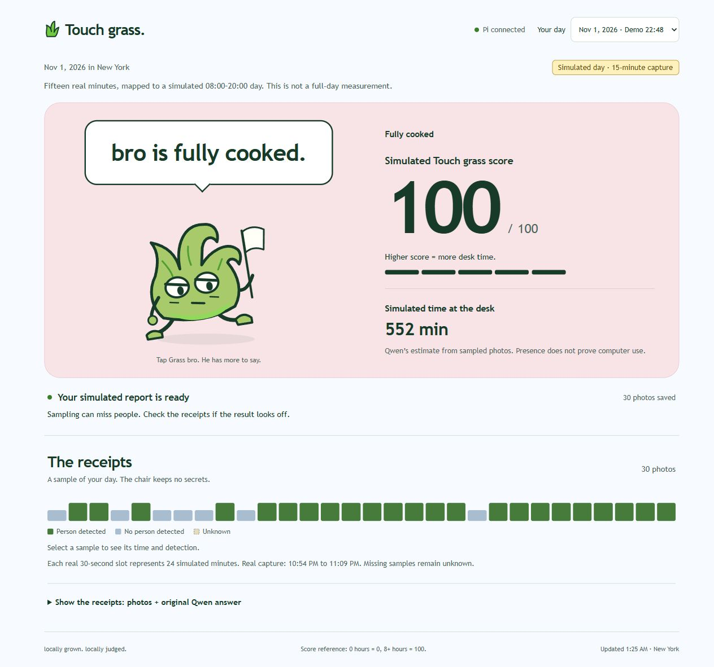

# Grass bro UI: deployment and checks

On November 2, Marius approved the displayed grass-pet proposal and requested Pi deployment and README updates. This round is complete. Open the [Pi page](http://192.168.1.39:8080/).

## Changes

The page uses one grass character with expressions for five score bands. Clicking the character cycles through copy in the same band, and Enter also works. Waiting, capturing, capture complete, processing, validation failure and offline states have their own poses and explanations. Switching dates clears the previous result before loading the new one. Automatic polling preserves the selected caption and does not replay click feedback.

Source files are in `Study HQ/Projects/INFO5345/Lab5/touch_grass/ui/` in the workspace. `build-ui.cjs` generates three static files for the Pi service's existing routes. Deployment replaced only `/home/pi/touch-grass/web/index.html`, `style.css` and `app.js`. Backend, model, sampling and GPIO behavior were unchanged.

The previous interface is backed up at `/home/pi/touch-grass/backups/grass-ui-20261102-012015/web/` on the Pi. Both services and live YOLO retained their existing processes. Deployment did not restart capture or analysis.

## Actual screenshots

The current report still comes from the second run's 30 real photographs, mapped to a simulated 08:00–20:00 day. It displays the existing Qwen result: 552 simulated minutes and 100 points. The first screen continues to label the 15-minute capture and simulated day.

- [Phone-width screenshot](mobile.jpg): a 360px browser viewport, not a photograph of a physical phone.
- [Tablet-width screenshot](tablet.jpg): a 768px browser viewport, with another caption in the same band after clicking the character.
- [Short setup-test screenshot](setup-low-score.jpg): the earlier setup batch shows 0.1 minutes and 0 points, not a whole day.
- [Expanded photograph records](receipts.jpg): original samples and actual capture times remain accessible.

## Verification results

| Check | Result |
| --- | --- |
| Model values | The page matches the saved original Qwen answer. Duration and score were not recalculated. |
| Data preservation | Before-and-after hashes match for all second-run photographs, jobs and reports. Backend Python files also match. |
| File deployment | All three HTTP responses are byte-identical to the local build. The backup is retained. |
| Services and live preview | `touch-grass.service` and `touch-grass-screen.service` remained running with the same processes. The existing live YOLO process also remained. |
| Score and operating states | Node checks passed for all five band boundaries, invalid values, hiding old reports while processing, six operating poses and polling state identifiers. |
| Click and keyboard input | Mouse clicks and Enter change the caption. Automatic updates preserve the selection. The score does not change. |
| Historical reports | Switching between the simulated report and the earlier setup test works, with the correct simulation and setup labels. |
| Record access | The timeline shows actual and simulated times. Original model answers match, and photographs load. |
| Responsive layout | No horizontal overflow at 360px, 375px, 768px or 1280px. Phone-width, tablet-width and desktop screenshots were reviewed. |
| Reduced motion | The browser reported reduced motion enabled. Clicking adds the response style, but animation is suppressed and the caption still changes. System settings were not altered. |
| Browser errors | No page-script warnings or errors were captured during the checks. |

Apart from the two existing reports, score bands and operating states were checked with local software inputs. No new capture, deliberate Pi disconnection or fabricated experiment data was used for UI testing. Actual motion with reduced motion disabled was not checked. Narrow-width checks do not establish physical-phone acceptance.

This UI change does not improve person detection. The second run's five missed detections of visible people remain recorded. A complete day and nighttime processing still require an actual run.

## Check files

- [Deployment record](deployment.json): backup location and final deployed file hashes.
- [Before](before.json) and [after](after.json): backend, demo data, services and YOLO comparison.
- [Current report state](state.json): the existing simulated result used in this round.
- [Browser checks](browser-checks.json): visible results, layout, interaction and reduced-motion observations.
- [Documentation checks](document-checks.json): original assignment structure, historical errors and local links.

Build, test and recovery instructions are in [implementation and operation](../../implementation-and-operation.md). Character design and expression references are retained in the [UI redesign proposal](../../ui-redesign-proposal.md).
