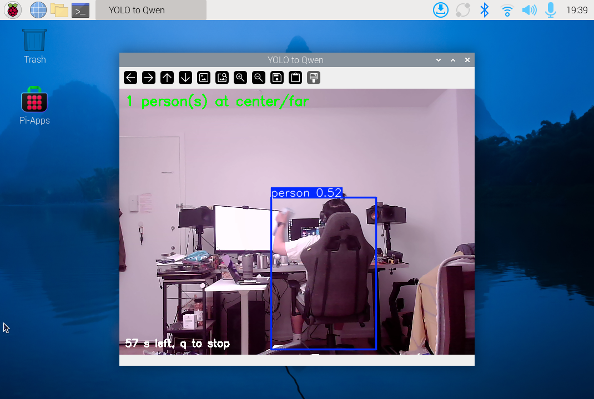

# Part E: detector, log and Qwen

The course pipeline ran on the Pi on November 1, 2026, at approximately 19:39 New York time. Codex executed the script and gave live movement prompts. Marius confirmed afterward, translated from Chinese: “Yes, I left and returned as prompted.” This confirms an actual exit and return during the test, rather than a sequence inferred only from detections.

## Run and results

```bash
cd '/home/pi/Interactive-Lab-Hub-Lab5/Lab 5'
.venv/bin/python -u yolo_to_qwen.py --seconds 60
```

The teacher's script was unchanged before and after the run. It used the NCNN YOLO model, image size 320, confidence 0.4, person detections only, and a nominal 0.5-second wait between readings. Position came from the bounding-box center's third of the frame. A box taller than 60% of the frame was labeled `close`; the others were `far`.

- [Original watch log](watch_log.txt): 15 change records, including 8 readings of `1 person(s) at center/far` and 7 of `nobody`.
- [Complete console output](console.txt): the actual Qwen response and its 18.5-second request time.
- [Run metadata](run.json): commands, settings, process outcome, timestamps and the original script hash.
- [Verification](verification.json): local evidence checks and integrity results.

The Qwen request used `qwen3.5:0.8b`, thinking disabled, temperature 0.2 and a 250-token limit. The question was the course default. No retries or prompt changes were made after the answer appeared.

## What the evidence supports

The pipeline completed with exit code zero. Detection alternated between one person and no detection, with no other location or distance label. The log contains no person identities and cannot establish five distinct visitors. Qwen's claim of five people has no basis in this log. Its claim of no activity also disagrees with Marius's report of entering and leaving.

The live instructions requested an empty view, entry at center, movement toward the left and closer to the camera, then exit. These are instructions, not measured actions. Marius confirmed the exit and return. The log did not demonstrate the requested left/close transition. A missing detection can reflect absence or a missed detection, so not every transition can be attributed to a physical entry or exit.

## Screenshots



The first screenshot shows one person at `center/far`, with part of the person hidden by a chair. It was captured from the actual Pi desktop.

The second raw capture is named [nobody.png](nobody.png) because a `nobody` log line triggered capture. By the time the desktop image was taken, the UI had already changed back to `1 person(s) at center/far`. Its filename is not evidence of an empty scene. `run.json` retains the trigger reading and the later capture timestamp.

The main [README](../../README.md#part-e) contains the original response and the concise comparison. No overnight recording was made in this run.
