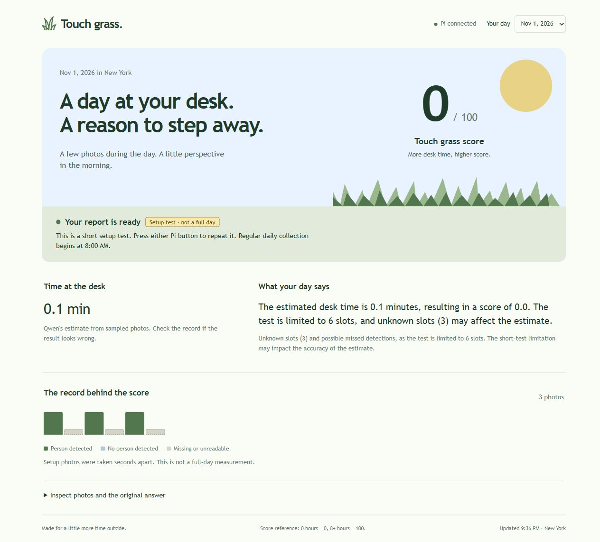

# Touch grass deployment and short setup check

This record covers actual Pi services, camera photographs and model responses. The short dataset checks the workflow and does not represent a full day at the desk.

## Deployment result

Hashes matched for ten corresponding source files on Windows and the Pi. The main and Mini PiTFT services were running and enabled at boot. The old `piscreen.service` was stopped and disabled, with its program, unit file and pre-deployment state preserved.

- [Deployment check](deployment-check.json) records source correspondence, service status, the next capture time and the screen program's heartbeat.
- [HTTP check](http-check.json) records LAN access from Windows to the page and API. Unauthenticated processing requests were rejected, and the data directory and invalid media paths were not readable through the web interface.
- The [desktop](ui-ready-desktop.jpg) and [narrow-width](ui-ready-mobile.jpg) screenshots came from the actual Pi page. The narrow layout had no horizontal overflow, and the browser recorded no errors.
- Windows and Pi checks passed for dates, time zones, startup boundaries, held-button debounce, duplicate jobs and output validation. Validation does not replace model numbers.

The first normal capture was scheduled for November 2 at 08:00 New York time. At this stage, physical button events still awaited Marius's operation. A screen-service heartbeat does not establish physical-button acceptance. No reboot test was performed.

## Three real photographs

The [test batch](2026-11-01/day.json) preserves three actual capture times: 21:00:53, 21:00:56 and 21:01:00. YOLO classified all three frames as containing a person. The first original photograph was reviewed and shows a person at the desk.

The test sampling interval was two seconds, but camera initialization and reads also took time. It therefore did not produce six consecutive successful samples. The six-slot sequence sent to Qwen was `P U P U P U`. `U` means unknown, not confirmed absence.

Under the test prompt's rules, three `P` slots each represent two seconds, totaling six seconds or 0.1 minutes. On the current eight-hours-to-100-points scale, the rounded score should be 0. This is a manual review of the experimental answer, not the program calculating daily results in place of Qwen.

## Model iterations

| Record | Model and settings | Original result | Review |
| --- | --- | --- | --- |
| [Initial check](model-checks/preflight/report.json) | qwen3.5:0.8b, thinking disabled | 10 minutes, 75 points. | Incorrect values. The initial format and daily-range checks did not catch them. This was not imported into the page as the day's result. |
| [First thinking attempt](model-checks/preflight-v2/report.json) | qwen3.5:0.8b, smaller output budget | No final answer. | Reached the generation budget. The Ollama response is preserved, but this is not a successful report. |
| [Explicit formula](model-checks/preflight-v3/report.json) | qwen3.5:0.8b, thinking disabled | 1.25 minutes, 48 points. | Rejected for exceeding the duration this record could represent. |
| [Simplified state sequence](model-checks/preflight-v4/report.json) | qwen3.5:0.8b, thinking disabled | About 0.333 minutes, 100 points. | Arithmetic remained incorrect. Rejected by the duration bound. |
| [Existing-model comparison](model-checks/qwen3-comparison/report.json) | qwen3:0.6b, thinking disabled | 1 minute, 100 points. | Rejected by the duration bound. |
| [Existing model with thinking](model-checks/qwen3-thinking/report.json) | qwen3:0.6b, thinking enabled | 0.1 minutes, 2 points. | Correct duration, but the score does not follow the prompt's linear scale. Passing format and range checks does not prove correct arithmetic. |
| [Larger thinking budget](model-checks/qwen35-thinking/report.json) | qwen3.5:0.8b, thinking enabled | Still no final answer. | Exhausted the budget after about nine and a half minutes. This model was not used in the final service. |
| [Final service test](2026-11-01/jobs/213433-728484/report.json) | qwen3:0.6b, thinking enabled, equivalent score formula simplified to minutes divided by 4.8 | 0.1 minutes, 0 points. | Duration and score match this short record. The Qwen request took about 37 seconds. |

Each directory retains detection boxes, timing records, the complete prompt, the original model answer and the Ollama response. At this stage, the program checked the maximum duration supported by the record, allowing one sampling interval of quantization tolerance. It did not correct model duration or score. That bound cannot detect every arithmetic error.

## Final software-triggered flow

The final check started the real queue through the local control endpoint. Its input source is labeled `software-check` in the [event log](button-events.jsonl). The service ran YOLO, Qwen and report saving in sequence, and the page automatically changed from processing to complete. The physical-button count was still zero, so this API call is not evidence of a successful physical press.

The [processing screenshot](ui-processing.jpg), [narrow report](ui-report-mobile.jpg), [final sampling log](2026-11-01/jobs/213433-728484/night_log.jsonl) and [final original model answer](2026-11-01/jobs/213433-728484/raw-response.txt) are saved. Both page widths were checked without horizontal overflow or browser errors.

The test batch can be rerun with a Mini PiTFT button to check physical input later. A completed normal daily batch does not rerun; a new batch starts automatically at 08:00 the next day. One correct short-record answer does not establish reliable estimation from longer logs.

## Still to verify at this stage

- Physical button input and screen changes as the job progresses.
- A complete day of five-minute sampling followed by nighttime processing.
- Qwen's duration estimates, score quality and runtime with longer logs.
- The user's storyboard, actual feedback and a video of the complete system.
