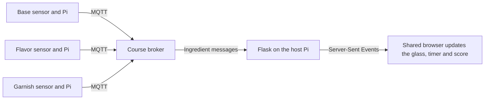

# Lab 6 | Color Cocktail Bar

**Hanle Gu (hg542)**  
I worked with Shenye Wang (sw2486) and Bowei Huang (bh654).

We built a game where three people make one drink. A red object selects strawberry for the player choosing the base, cherry for the player choosing the flavor, and a paper umbrella for the player choosing the garnish. We put the order and the glass on one laptop so we could see which ingredient was still missing while our hands were at the sensors.

## Part A | Sending my first MQTT message

I started with two Mosquitto clients on my Raspberry Pi. I subscribed to `IDD/#` in one terminal and sent `Hello!` to `IDD/test/marius` from the other. At 3:46 p.m. on November 8, the first terminal printed `IDD/test/marius Hello!`. I could now follow a message from my Pi to the course broker and back to my subscriber. [MQTT receipt](evidence/part-a-mqtt.json)

We considered five ways to use that exchange across devices.

| Idea | Interaction |
| --- | --- |
| Mix a target color | Each player sends the color under their sensor. Everyone adjusts their own input while watching the combined color on a display. |
| Play one instrument together | One Pi changes pitch, another keeps time, and a third controls volume. A computer turns those messages into music. |
| Show who is nearby | A Pi sends a change when someone approaches or leaves. A display in another room shows which locations are occupied. |
| Pass a gesture around | Each player sends a gesture from their Pi. The game checks the messages against a sequence and advances when the group gets it right. |
| Show the mood of a room | Several Pis measure light or activity. One computer interprets the readings and sends a shared room state back to the displays. |

We also considered a color lock that opens when everyone holds the right color for two seconds. We used that timing rule for the drinks.

## Part B | Finding my tile on the pixel grid

When I set up my Pi, the Mini PiTFT still showed *Touch grass* from Lab 5. I connected the APDS-9960 color sensor to my Raspberry Pi 5 and ran the pixel-grid publisher. My Pi found the sensor at `0x39` on I²C bus 1 and sent its color readings to `IDD/pixelgrid/colors`. On the class grid, my tile was the one at the bottom left. [Course publisher](https://github.com/IRL-CT/Interactive-Lab-Hub/blob/Fall2026/Lab%206/pixel_grid_publisher.py)

I held two differently colored objects in front of the sensor. My tile went from pale blue to turquoise. The RGB value at the center of each screenshot matched the value my Pi had sent. [Readings and timestamps](evidence/part-b-readings.json)

| My Pi before the test | First reading | After I changed the object |
| --- | --- | --- |
|  |  |  |
| The TFT still shows Lab 5. | RGB (186, 204, 255) | RGB (78, 255, 227) |

Each of us had a Pi and a color sensor on the table. [Shenye's setup](https://github.com/user-attachments/assets/511c006d-ebd8-4784-a8bb-c9f63d6dc416) · [Bowei's setup](https://github.com/user-attachments/assets/f10dca43-244e-4521-902f-b680a8be2645) · [Shenye's pixel-grid video](https://github.com/user-attachments/assets/95009eee-a4cc-4b49-87d5-eafd7e94d4da)

## Part C | Making a drink together

We gave each player one ingredient to control. We could change our selections at the same time or add them one by one. To earn a point, we had to match the whole order and hold all three selections for two seconds. When we moved an object away, the sensor recognized its background and cleared that ingredient.

| What we controlled | Red | Green | Blue |
| --- | --- | --- | --- |
| Base | Strawberry | Green apple | Blueberry |
| Flavor | Cherry | Lime | Blue syrup |
| Garnish | Paper umbrella | Mint leaves | Star stirrer |

In the two photos below, we were working on *The Garden Party*. We brought the flavor sensor up to a red bottle, and cherry appeared on the screen. The base and garnish were both offline, so we could see the flavor appear in the glass while the order stayed open.

| At our table | On our screen |
| --- | --- |
|  |  |

### Getting from the sensor to the glass

Our blue sample gave us a calibration problem. The flavor Pi measured an average of **(156.6, 255.4, 209.2)**. Green was the largest reading even though the object was blue. We took reference readings for red, green, blue, and the uncovered sensor. The program divides each channel by the sum of all three, compares those proportions with the references, and waits for three consecutive classifications to agree before changing the ingredient. [Flavor calibration](cocktail/calibration_B.json) · [Sensor program](cocktail/cocktail_sensor.py)

```python
r, g, b, light = sensor.color_data
rgb = [r, g, b]
color = stable.update(classify(rgb, light, references))
```

We gave each ingredient its own topic. Each Pi publishes its current selection twice a second. Our Flask server listens to all three topics, checks that the input named in the message matches its topic, and sends the reading to the browser. [Server program](cocktail/cocktail_server.py)

| Ingredient | MQTT topic |
| --- | --- |
| Base | `IDD/sw2486/cocktail/input/A` |
| Flavor | `IDD/sw2486/cocktail/input/B` |
| Garnish | `IDD/sw2486/cocktail/input/C` |



We needed the game to distinguish a player holding a color steady from a Pi that had stopped sending. The browser drops an input from scoring after five seconds without a message. While all three inputs are current, the code below measures how long the colors match. If one player moves away early, the timer starts over. [Game code](cocktail/templates/color_cocktail_bar.html)

```javascript
if (!matched) return {start:null,complete:false,progress:0,awarded:false};
const start=state.start === null ? now : state.start;
const progress=Math.min(1,(now-start)/2000);
return {start,complete:progress>=1,progress,awarded:progress>=1};
```

### Playing a round

We first used the on-screen buttons in Demo mode to check the ingredient mapping and scoring. When we switched to Live mode, the sensors controlled those same selections. During *Blue Hour Special*, blueberry appeared first. Cherry appeared next while the garnish was still offline. In another round, all three inputs came online and we completed order 036, *A Berry Good Time*. [Demo controls](https://github.com/user-attachments/assets/0456c663-4883-4a3b-a558-0bca58cfae2d) · [Blueberry](https://github.com/user-attachments/assets/30f4f758-074a-491f-889c-d83b6cf20d2d) · [Blueberry and cherry](https://github.com/user-attachments/assets/56174d4f-23c6-4544-afb2-b197ca4ce06a)


### Where we put the game logic

We kept color recognition on each Pi because each sensor had its own reference readings. Changing the setup can mean taking a new set of samples.

We played on one laptop because each browser generates its own orders and keeps its own score. We shared sensor readings across devices, but opening a second browser would start a different game. Sharing one round across multiple screens would require the host to keep track of the order and score as well.

### Trying it with two other players

Two friends from outside our group tried the game. Both enjoyed the game and liked how it was made. Neither had a specific change to suggest. We recorded their reactions after the session. Their expectations going in and anything that surprised them are still open questions for a follow-up. [Photo from our test session](https://github.com/user-attachments/assets/8ce9471f-477b-4123-b69c-71e01bafdbcf)

### My reflection

The color I got from the sensor changed a lot with the lighting and how close I held it to the object. I had to hold one particular side of the sensor right up against the colored surface, which didn't feel intuitive to me. The readings also seemed to vary from one sensor to another.

### Running our setup

For Demo mode, open the [game HTML](cocktail/templates/color_cocktail_bar.html) locally. For Live mode, install the [Pi dependencies](requirements-pi.txt) on each sensor Pi and the [server dependencies](requirements-server.txt) on the host. From the `Lab 6` directory, start the host with `python cocktail/cocktail_server.py`. The flavor Pi uses the command below with our saved calibration. The other two Pis use their own ingredient argument and calibration file.

```sh
python cocktail/cocktail_sensor.py --station B --calibration cocktail/calibration_B.json
```

The programs prompt for the course MQTT login if it is not set in the environment. Open the host on port 8000 in a browser, select **Live sensors**, and click **Connect**.

**Team materials**  
I included my classroom photos and pixel-grid readings here. Shenye shared the game captures, and Bowei documented the playtest. [Shenye's notes and reflection](https://github.com/sw2486-hub/Interactive-Lab-Hub/blob/4a1eb616326efe20b33ee9c5ca16b89e22530188/Lab%206/README.md#6-reflection) · [Bowei's test notes and photo](https://github.com/bh654-dev/Interactive-Lab-Hub/blob/5724b5f8a9241a2a04012259836139f96973158f/Lab%206/README.md#user-testing)

**AI assistance**  
We used ChatGPT for setup guidance. I used Codex to run the pixel-grid check, compare the readings with the screenshots, and help edit and publish this write-up. I wrote my reflection in Chinese and used Codex to translate it into English.
