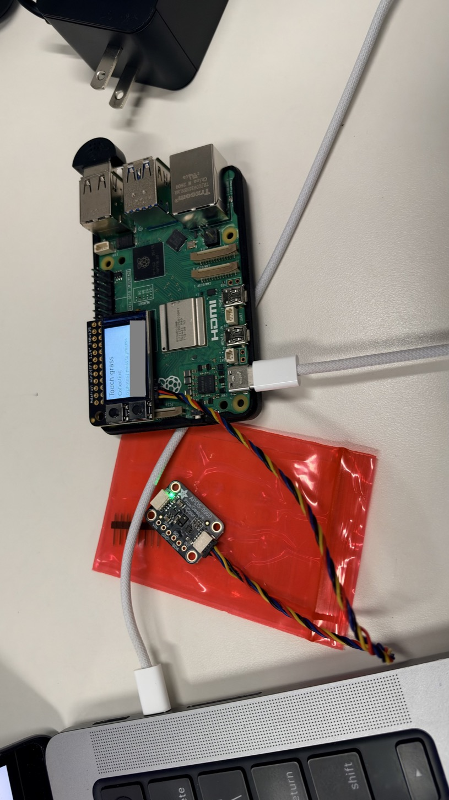
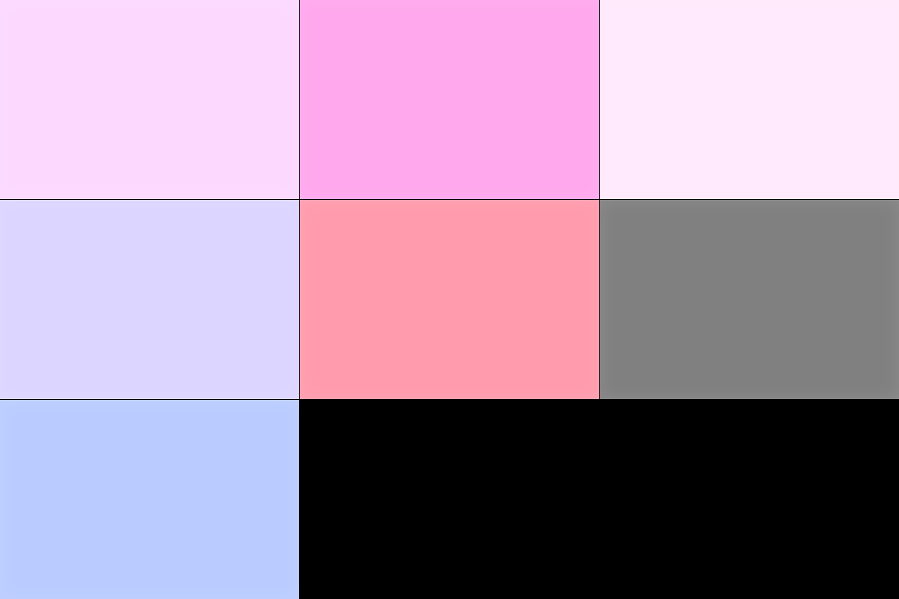
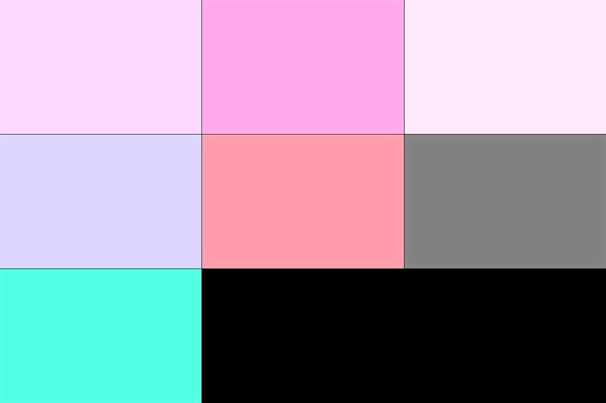
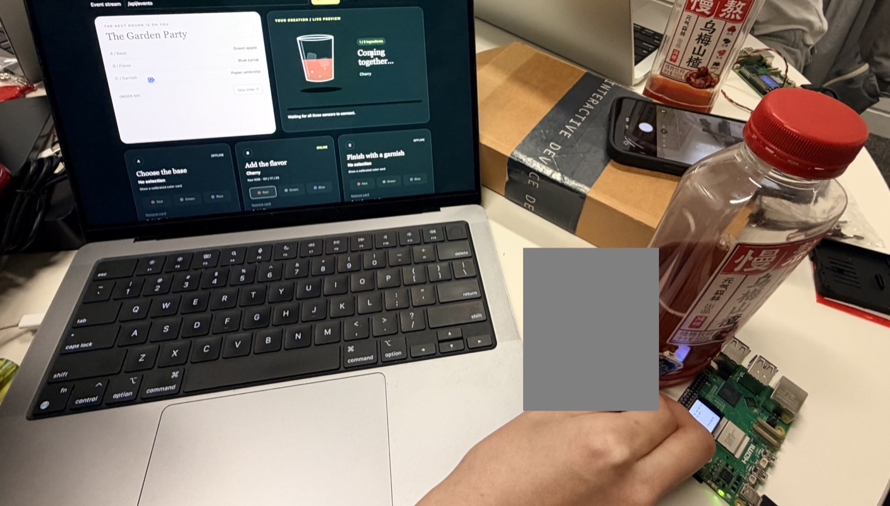
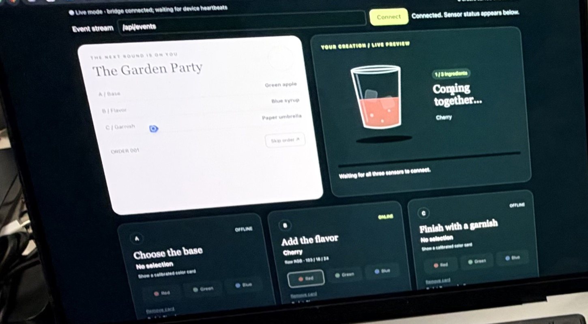
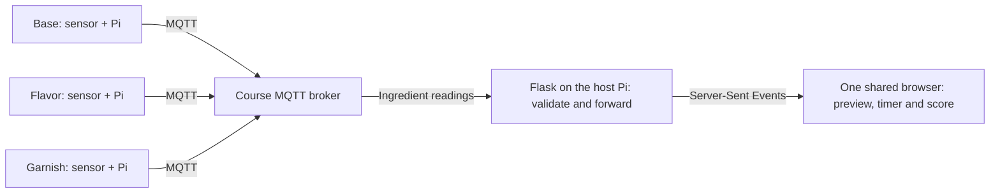

# Lab 6: Distributed Interaction | Color Cocktail Bar

**Team:** Hanle Gu (hg542), Shenye Wang (sw2486), and Bowei Huang (bh654).

Three people make one virtual drink. Each uses a Raspberry Pi and a color sensor to choose one ingredient: the base, the flavor, or the garnish. All three players can see the order and the glass on one laptop. Nobody can finish an order alone.

## Part A: A message between devices

On November 8, Hanle opened two Mosquitto clients on his Pi. One subscribed to the course broker. The other sent `Hello!` to `IDD/test/marius`. At 3:46 p.m. New York time, the subscriber printed `IDD/test/marius Hello!`. [Message receipt](evidence/part-a-mqtt.json)

[Shenye's brainstorm](https://github.com/sw2486-hub/Interactive-Lab-Hub/blob/4a1eb616326efe20b33ee9c5ca16b89e22530188/Lab%206/README.md#part-a-mqtt-messaging) records five ways devices could use the same publish/subscribe pattern:

| Idea | What one device sends | What the other end does |
| --- | --- | --- |
| Color mixer | Each Pi sends its RGB reading. | One display blends the colors so players can match a target. |
| Shared instrument | Pis send pitch, rhythm, or volume changes. | A computer plays the combined musical phrase. |
| Remote presence | A Pi reports whether someone is near it. | Displays in other locations show which spaces are occupied. |
| Gesture sequence | Each player sends a detected gesture. | The game checks whether the group performed the gestures in order. |
| Room mood | Pis report light, motion, or proximity. | A controller combines the readings and sends one room state back to the displays. |

[Bowei's brainstorm](https://github.com/bh654-dev/Interactive-Lab-Hub/blob/5724b5f8a9241a2a04012259836139f96973158f/Lab%206/README.md#part-a-mqtt-messaging) includes another related idea, *Color Lock*: every player has to hold the right color for two seconds. That same timing rule appears in the cocktail game.

## Part B: Collaborative Pixel Grid

Hanle connected an APDS-9960 to his Raspberry Pi 5. The Pi recognized the sensor on I²C bus 1 at address `0x39` and initialized the Mini PiTFT. The [course publisher](https://github.com/IRL-CT/Interactive-Lab-Hub/blob/Fall2026/Lab%206/pixel_grid_publisher.py) sent RGB values to `IDD/pixelgrid/colors`. On the course grid, Hanle's Pi occupied the bottom-left tile.

| Hanle's setup | First grid reading | After changing the object |
| --- | --- | --- |
|  |  |  |
| Before the test; the TFT still shows the previous lab. | RGB (186, 204, 255) | RGB (78, 255, 227) |

In both screenshots the center pixel matched the RGB value the Pi had just published. The sensor log also contains both red-dominant and green-dominant readings from the two objects. [Timestamped readings](evidence/part-b-readings.json) · [Shenye's pixel-grid video](https://github.com/user-attachments/assets/95009eee-a4cc-4b49-87d5-eafd7e94d4da)

**Hardware across the team:** [Hanle's Pi and sensor](evidence/part-b-pi.jpg), [Shenye's setup](https://github.com/user-attachments/assets/511c006d-ebd8-4784-a8bb-c9f63d6dc416), and [the setup in Bowei's notes](https://github.com/user-attachments/assets/f10dca43-244e-4521-902f-b680a8be2645). The latter two photographs come from [Shenye's](https://github.com/sw2486-hub/Interactive-Lab-Hub/blob/4a1eb616326efe20b33ee9c5ca16b89e22530188/Lab%206/README.md#part-b-collaborative-pixel-grid) and [Bowei's](https://github.com/bh654-dev/Interactive-Lab-Hub/blob/5724b5f8a9241a2a04012259836139f96973158f/Lab%206/README.md#part-b-collaborative-pixel-grid) lab records.

## Part C: Color Cocktail Bar

### From a colored object to an ingredient

Each player presents an object to their sensor. A color selects a different ingredient depending on who holds it. When the three selections match the order for two uninterrupted seconds, the group earns a point. Moving an object away returns that input to its calibrated background and clears the selection.

| Player controls | Red | Green | Blue |
| --- | --- | --- | --- |
| Base | Strawberry | Green apple | Blueberry |
| Flavor | Cherry | Lime | Blue syrup |
| Garnish | Paper umbrella | Mint leaves | Star stirrer |

| The physical input | The shared screen |
| --- | --- |
|  |  |
| A player holds the sensor against a red bottle beside the Pi. | For *The Garden Party*, the flavor reads **Cherry**; the base and garnish are offline. |

These are two photographs of the same moment, provided by Hanle. They show a single ingredient registering. The completed order is a separate capture below.

### How the three Pis share a drink



Each Pi classifies colors locally using its own calibration. For the flavor sensor, the blue sample averaged **(156.6, 255.4, 209.2)**: picking the largest channel would have called it green. Instead, the program compares the proportions of all three channels with its red, green, blue, and background references. It waits for three consistent classifications before changing the selection. [Sensor code](cocktail/cocktail_sensor.py) · [Flavor calibration](cocktail/calibration_B.json)

| Ingredient | MQTT topic |
| --- | --- |
| Base | `IDD/sw2486/cocktail/input/A` |
| Flavor | `IDD/sw2486/cocktail/input/B` |
| Garnish | `IDD/sw2486/cocktail/input/C` |

The Pis send their current readings twice a second. The [server](cocktail/cocktail_server.py) checks that a message is fresh (not retained), comes from an ingredient topic, and names the same input as that topic. Only accepted messages are forwarded to the browser:

```python
def on_message(client, userdata, message):
    data = validate_message(message.topic, message.payload, message.retain)
    if data is not None:
        broadcast(data)
```

The [browser](cocktail/templates/color_cocktail_bar.html) separately checks when it last heard from each Pi:

```javascript
const fresh = (device,now) => Boolean(device && device.seen !== null && now-device.seen < 5000);
const matches = (target,devices,now) => stations.every(id => fresh(devices[id],now) && devices[id].color === target[id]);
```

A Pi that goes silent no longer counts toward an order after five seconds. If any ingredient stops matching during the two-second hold, the timer resets. Orders and scores belong to the browser, so the group played on one shared screen.

### What happened during play

In [Shenye's first live capture](https://github.com/user-attachments/assets/30f4f758-074a-491f-889c-d83b6cf20d2d), *Blue Hour Special* has only blueberry. In [the next capture](https://github.com/user-attachments/assets/56174d4f-23c6-4544-afb2-b197ca4ce06a), cherry joins the drink while the garnish is still offline. A separate live capture shows order 036, *A Berry Good Time*, marked complete with all three physical inputs online.


[Shenye's live captures](https://github.com/sw2486-hub/Interactive-Lab-Hub/blob/4a1eb616326efe20b33ee9c5ca16b89e22530188/Lab%206/README.md#5-actual-operation-screenshots) · [Manual demo screenshot](https://github.com/user-attachments/assets/0456c663-4883-4a3b-a558-0bca58cfae2d). The manual demo uses on-screen buttons and can be tried by opening the [HTML file](cocktail/templates/color_cocktail_bar.html) locally. Live mode uses the sensors and the Flask server.

**Running the live version:** From the `Lab 6` directory, install the [Pi dependencies](requirements-pi.txt) on the input Pis and the [server dependencies](requirements-server.txt) on the host. Start `python cocktail/cocktail_server.py` on the host. For example, the flavor Pi runs `python cocktail/cocktail_sensor.py --station B --calibration cocktail/calibration_B.json`. The other inputs use their own role argument and calibration. The programs prompt for the course MQTT login unless it is already set in the environment. Open the host on port 8000, select **Live sensors**, and click **Connect**.

### Testing with people outside the team

[Bowei's test note and photograph](https://github.com/bh654-dev/Interactive-Lab-Hub/blob/5724b5f8a9241a2a04012259836139f96973158f/Lab%206/README.md#user-testing) document a session with two friends who were not on the team. Bowei reports that both enjoyed the game and liked how it was made. Neither proposed a specific change. The team did not record what either person expected before playing or what surprised them. [Photograph from the session](https://github.com/user-attachments/assets/8ce9471f-477b-4123-b69c-71e01bafdbcf)

### Team reflection

In their published reflections, [Shenye](https://github.com/sw2486-hub/Interactive-Lab-Hub/blob/4a1eb616326efe20b33ee9c5ca16b89e22530188/Lab%206/README.md#6-reflection) and [Bowei](https://github.com/bh654-dev/Interactive-Lab-Hub/blob/5724b5f8a9241a2a04012259836139f96973158f/Lab%206/README.md#6-reflection) describe why they tested the interface in Demo mode first and how heartbeats helped distinguish a live selection from an old one. They suggest more consistent lighting at the sensors and moving the orders and score to the server so different browsers could share one game.

**AI assistance:** The team supplied the game files, calibration, brainstorms, test observations, and reflection sources. ChatGPT provided setup guidance. Codex ran the pixel-grid check, verified the recorded values, and helped organize and publish this technical documentation.
